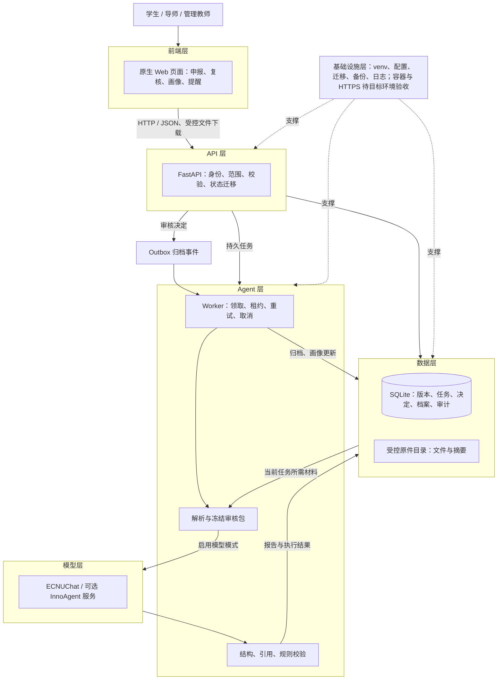
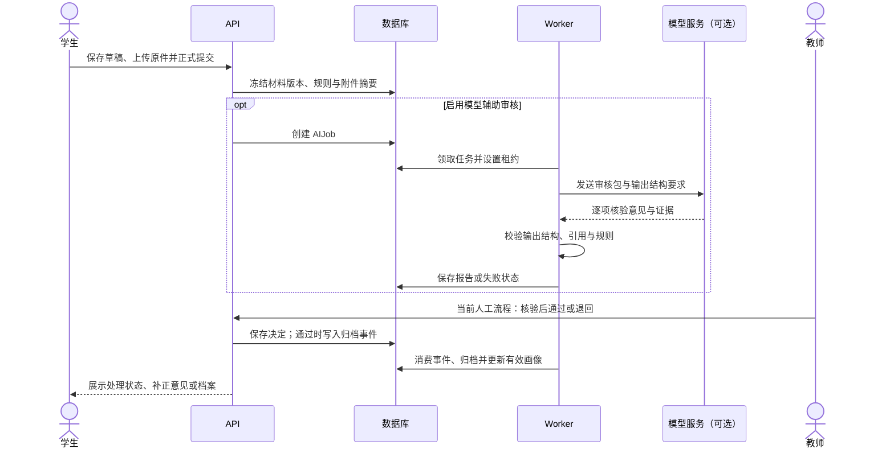
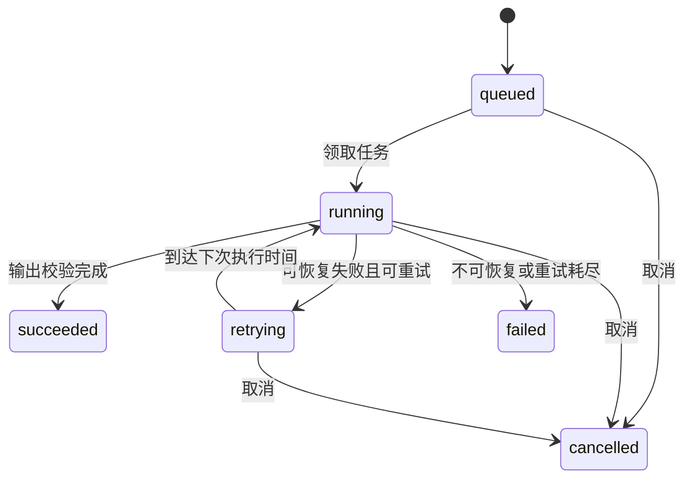
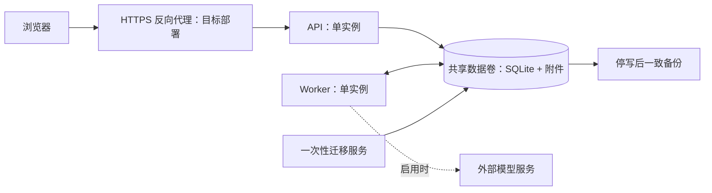

# InnoGrad 研究生培养智能审核与成长管理系统技术架构

> 按《Web 智能体技术架构设计模板》组织，参考健康智能助手的分层契约与固定流水线、海上风电运维方案的权限隔离与人工复核设计。实现依据为项目技术报告、当前源码、依赖锁文件及本机整合记录。
>
> **当前状态：**核心业务闭环已实现；本机课堂演示采用合成数据、规则模式和人工审核。ECNUChat 有历史联调记录；原生 InnoAgent 客户端已实现，本机服务未部署。目标服务器部署与模型质量评测尚未完成。

## 0. 文档信息

| 项目 | 内容 |
| --- | --- |
| 项目名称 | InnoGrad 研究生培养智能审核与成长管理系统 |
| 文档版本 | v1.1，模板对齐完善版 |
| 作者 / 小组 | InnoGrad 项目组；成员署名以课程提交信息为准 |
| 指导教师 | 当前项目材料未提供姓名，以课程登记信息为准 |
| 最后更新 | 2026-11-05 |
| 状态 | 评审稿；单机试点候选方案 |
| 实现基线 | `20261104-portable-rc1` 发布包及 2026-11-05 本机整合 |

| 版本 | 日期 | 修订内容 |
| --- | --- | --- |
| v1.0 | 2026-11-05 | 从技术报告整理总体架构、业务流程及汇报版设计说明 |
| v1.1 | 2026-11-05 | 对齐模板 0—12 章，补充分层输入输出、依赖版本、ADR、Agent 契约、人工复核、测试与演进计划 |

本文以“现状”“规划”“待验证”区分完成程度。测试数字引用已有记录，本次文档整理未重新执行业务测试。

**课堂两分钟展示路径：**第 3.1 节架构图（40 秒）→ 第 3.3 节核心流程（35 秒）→ 第 3.4 节架构决策（30 秒）→ 第 10 节验证结果（15 秒）。其余章节供评审查阅。

## 1. 项目概述

### 1.1 背景与目标

研究生的论文、年度报告、成果证明和教师反馈分散保存，教师需要重复核对标题、作者、成果状态和日期。材料补正容易覆盖旧信息，审核结果也难以持续用于培养指导。InnoGrad 将材料、规则、版本、证据和处理结论关联起来，形成“提交—核验—补正或通过—归档—画像—预警跟进”的闭环。智能审核模块负责生成逐项核验意见，业务系统负责访问权限、证据校验和正式状态迁移。

### 1.2 核心功能清单

下列优先级用于本方案的迭代排序。

| 编号 | 功能 | 优先级 | 当前状态 |
| --- | --- | --- | --- |
| F-01 | 多角色工作台与数据范围控制 | P0 | 已实现学生、导师、管理教师等角色及授权范围检查 |
| F-02 | 材料申报、附件与版本管理 | P0 | 已实现论文、年度报告、草稿、冻结提交和补正 |
| F-03 | 模型辅助审核与证据引用 | P0 | 已实现任务及接入代码；模型路径的校验能力仍需统一 |
| F-04 | 人工复核与异步归档 | P0 | 已打通；当前演示使用人工审核 |
| F-05 | 事实画像、材料覆盖与成长记录 | P1 | 已实现来源追溯和有效归档聚合 |
| F-06 | 预警与教师跟进 | P1 | 已实现五类业务规则及条件消除、历史跟进 |
| F-07 | 备份、恢复与迁移 | P0 | 脚本已交付，本机备份恢复往返已验证 |
| F-08 | 画像方法整合与培养全周期扩展 | P2 | 独立方法原型与后续规划，尚未全部进入业务应用 |

### 1.3 范围边界

当前应用主要覆盖论文与年度报告的申报、核验和归档，以及基于有效材料的事实画像与提醒。开题、中期、毕业、学位申请等独立流程尚属规划。

材料覆盖数量不等于学生能力分数，模型意见不等于学校正式认定。系统不以其他学生的材料支持本人的审核结论；模型不能直接写入正式档案或自主行使审批权限。显性画像、隐性素养、历史轨迹与研究指导方法分支尚未全部整合。

### 1.4 关键质量属性

| 属性 | 要求 / 目标 | 验证方式与当前证据 |
| --- | --- | --- |
| 可追溯性 | 正式结论关联提交版本、规则与原件，补正保留历史 | 版本与引用测试、附件 SHA-256 检查 |
| 权限隔离 | 未授权身份不能读取他人材料或原件 | 接口越权测试；本机记录包含跨学生拒绝访问 |
| 状态一致性 | 取消或过期任务不能回写；归档可重试且不重复生效 | 任务状态、并发与幂等测试 |
| 可恢复性 | 数据库与附件一致恢复 | 本机已验证数据库与 44 份合成附件恢复往返；RPO/RTO 尚未量化 |
| 响应时延与容量 | 分别测量 API、队列等待与模型执行耗时 | 尚无 P95、并发或可用性达标数据，试点前建立基线 |
| 模型质量 | 统计误通过、误补正、引用错误及无法判断比例 | 真实标注集待建立，不以单例成功代替准确率 |
| 成本 | 限制输入规模与输出长度，后续统计实际用量 | Chat 输入截断约 60,000 字符、输出上限 12,000 tokens；未建立成本看板 |

## 2. 开发与运行环境

### 2.1 程序设计语言及版本

| 用途 | 语言 / 版本 | 选择理由 |
| --- | --- | --- |
| API、审核编排、脚本 | Python ≥3.11；Dockerfile 使用 3.12；当前 Mac 环境 3.14 | 统一文档处理、模型请求、业务接口与测试生态 |
| 浏览器交互 | 原生 JavaScript、HTML、CSS；未声明固定 ECMAScript 版本 | 快速验证多角色业务，不增加前端构建服务 |
| 数据与迁移 | SQLAlchemy 模型、Alembic 迁移脚本 | 版本化管理数据库，避免手工修改模式 |

### 2.2 开发工具

| 类别 | 工具 | 用途 / 版本说明 |
| --- | --- | --- |
| 版本管理 | Git、GitHub | 分支协作与架构文档展示；未统一声明客户端版本 |
| 依赖环境 | venv、pip | 隔离 Python 环境，依据锁文件安装 |
| 接口调试 | FastAPI `/docs`、HTTP 客户端 | 查看 OpenAPI 和调试业务请求 |
| 测试检查 | pytest、Node 原生测试、Python 编译与 JS 语法检查 | 后端与前端验证；Node 不作为业务服务运行依赖 |
| 编辑工具 | 团队成员自选 | 当前材料未统一记录 IDE 与插件版本，不作为部署前置条件 |

### 2.3 系统运行环境

| 环境 | 运行方式 | 当前状态 |
| --- | --- | --- |
| Windows 开发环境 | Python API + Worker | 原技术报告记录完成复现与 ECNUChat 联调 |
| macOS 本机演示 | 独立虚拟环境、API + Worker、端口 8765 | 进程内集成验证通过；浏览器点击与端口监听需现场确认 |
| Linux 目标服务器 | Python 3.12 容器、Compose、HTTPS 代理 | 配置已交付，目标主机验收待执行 |

模型经远端 API 调用，业务主机不要求本地 GPU。CPU、内存、磁盘与并发容量尚未完成压测定型，按试点样本和附件规模测量后确定。

### 2.4 使用平台与外部服务

| 平台 | 用途 | 访问与费用 |
| --- | --- | --- |
| GitHub | 源码、分支及课程文档 | 项目仓库 `NamingIsVeryVeryHard/InnoGrad` |
| ECNUChat | Chat Completions 模型服务 | Bearer Token；额度与计费以学校授权为准，未测算单次费用 |
| InnoAgent | 可选独立 Agent 服务 | HTTP/SSE 客户端已实现，需单独部署和配置 |
| 校内或受控服务器 | 后续单机试点 | 目标环境资源和运维成本待确认 |

### 2.5 依赖清单与版本锁定

以下版本来自 [requirements.lock.txt](../../backend/requirements.lock.txt)，不是示例推荐值。

| 依赖 | 锁定版本 | 用途与理由 |
| --- | --- | --- |
| FastAPI | 0.162.0 | 类型驱动接口与 OpenAPI 文档 |
| Uvicorn | 0.54.0 | 运行 ASGI 应用 |
| Pydantic | 2.14.1 | 输入、模型输出及证据结构校验 |
| SQLAlchemy | 2.1.6 | 关系模型及事务管理 |
| Alembic | 1.20.1 | 可复现的数据库迁移 |
| httpx | 0.28.1 | 模型 HTTP 请求与超时控制 |
| pypdf | 6.21.4 | 可提取文本 PDF 的解析 |
| python-dotenv | 1.2.4 | 环境配置加载 |
| python-multipart | 0.0.32 | 附件上传 |
| psycopg / psycopg-binary | 3.3.6 | 保留 PostgreSQL 接入能力，尚未完成切换验收 |
| pytest | 9.2.0 | 后端自动化验证 |

完整传递依赖以锁文件为准。前端原型没有 npm 构建依赖；本机虚拟环境不能直接复制到其他操作系统使用。

### 2.6 配置与密钥管理

| 配置 | 说明 | 敏感性 / 存放位置 |
| --- | --- | --- |
| `AI_MODE` | `rules/chat/agent/innoagent` 模式选择 | 非密钥，服务端环境 |
| `REVIEW_WORKFLOW` | 人工或自动业务流转；与模型模式独立 | 服务端环境；当前 `manual` |
| `AI_BASE_URL`、`AI_MODEL` | 模型地址与请求别名 | 服务端配置，不接受材料指定地址 |
| `AI_API_KEY` | 模型凭据 | 敏感；本地私密配置或部署环境，不进 Git、不发到浏览器 |
| `DATABASE_URL`、`FILE_ROOT` | 数据库与附件位置 | 服务端环境；含数据库凭据时按敏感项处理 |
| `COOKIE_SECURE` | HTTPS 下的安全 Cookie 配置 | 正式 HTTPS 设置为 1 |
| `AI_MAX_ATTEMPTS`、`AI_RETRY_SECONDS` | 示例值 3 次、10 秒，控制重试 | 服务端环境，按模式处理 |
| `INNOAGENT_TIMEOUT_SECONDS`、`INNOAGENT_QUEUE_TIMEOUT_SECONDS` | 示例均为 600 秒 | 原生服务执行与排队期限 |

`.env.example` 给出 Chat 配置示例；本机演示启动器显式使用 `rules/manual` 和独立数据目录，不读取生产配置。已有演示凭据仅供本机私密使用，不随源码发布。

## 3. 总体架构

### 3.1 六层架构图



图中模型分支在相应模式下启用。本机演示走人工核验；自动流程由应用校验后决定状态，模型没有独立审批通道。

### 3.2 分层职责、输入输出与依赖

| 层 | 输入 | 职责与技术 | 输出 | 依赖 |
| --- | --- | --- | --- | --- |
| 前端 | 用户表单、文件、后端状态 | 原生 Web 交互与引用展示 | API 请求、业务视图 | 浏览器、API |
| API | 登录、提交、复核等请求 | FastAPI + Pydantic；权限、事务和状态约束 | 业务 JSON、任务 ID、受控原件 | 数据层、后台任务契约 |
| Agent | 冻结版本、规则、附件与任务配置 | 自研 Python 流水线；解析、执行、校验与恢复 | 核验报告、失败码、元数据 | 模型服务、任务表、原件 |
| 模型 | 审核包、指令、输出 Schema | 文本理解与逐项核验 | `checks` 与引用 | ECNUChat 或独立 InnoAgent |
| 数据 | 业务记录、附件、报告、决定 | SQLite、SQLAlchemy、文件目录 | 可追溯状态、有效档案与证据 | 迁移与备份设施 |
| 基础设施 | 配置、代码包、数据卷 | 启停、日志、迁移、恢复 | 可运行环境、健康与恢复记录 | Python、操作系统；部署方案另需容器与代理 |

### 3.3 核心请求时序



材料状态为 `draft/returned → pending_review → approved → archived`；退回进入 `returned`，补正后再次提交形成新版本。

任务独立维护 `queued/running/retrying/succeeded/failed/cancelled`。**任务成功表示报告执行完成，不能等价为材料通过。** 前端须分别表达业务状态和任务状态。

### 3.4 架构决策记录（ADR）

| 编号 | 决策 | 备选方案 | 选择理由 | 代价 / 风险 |
| --- | --- | --- | --- | --- |
| ADR-01 | 原生 Web + FastAPI | React/Vue 构建工程、一体化演示框架 | 快速打通真实接口，降低启动依赖 | `app.js` 较集中，后续需要模块拆分 |
| ADR-02 | 固定审核流水线 | ReAct 自主规划、多 Agent 协作 | 材料核验步骤明确，权限与证据检查必须执行 | 灵活性较低，新增流程需显式开发 |
| ADR-03 | 数据库任务表 + 单 Worker | Redis/Celery、独立消息代理 | 复用事务状态，适合单机试点与恢复 | 横向扩展能力有限 |
| ADR-04 | SQLite + 受控目录 | PostgreSQL + 对象存储 | 部署简单，便于一致备份 | 不适合直接扩为多机集群 |
| ADR-05 | 模型报告与业务决定分离 | 模型直接审批或写库 | 错误输出不能直接改变正式档案 | 增加校验与人工复核工作 |
| ADR-06 | 版本、规则冻结与原件哈希 | 原地更新当前材料 | 避免新规则、补正或旧任务覆盖历史依据 | 增加版本存储与关联复杂度 |
| ADR-07 | ECNUChat 直接调用，保留原生接口 | 仅绑定一个运行时、本地部署模型 | 复用学校模型服务，允许后续替换 | 外部服务依赖；两条路径校验尚不一致 |

## 4. 前端层（Presentation Layer）

### 4.1 主要职责

采集申报字段与附件，展示材料状态、核验意见、原件引用和成长记录；将教师操作交给 API 校验。服务端保存权威状态，前端仅管理交互状态。

### 4.2 技术选型

原生 HTML/CSS/JavaScript 配合浏览器 HTTP 请求，无 React/Vue、Vite 或组件库依赖。理由是当前优先验证业务闭环和迁移复现。后续应拆分集中页面代码、减少全量刷新并增加服务端分页；迁移框架需根据维护规模另行决策。

### 4.3 页面与关键状态

| 页面 | 输入 / 关键状态 | 输出与职责 |
| --- | --- | --- |
| 工作台与任务 | 当前身份、授权范围、任务完成情况 | 待办入口与概览 |
| 材料申报与详情 | 草稿、版本、附件用途、提交状态 | 保存、正式提交、补正 |
| 审核队列 | 待审版本、报告、教师意见 | 通过或退回请求 |
| 成长画像 | 学生、时间范围、有效归档 | 材料覆盖、归档趋势与来源追溯 |
| 关注与提醒 | 规则触发条件、跟进历史 | 跟进记录、条件消除状态 |

### 4.4 与后端交互

业务接口前缀为 `/api/v1`。Session Cookie 建立登录态，变更请求按接口要求携带 CSRF Token、幂等键与版本锁。材料详情轮询任务进度，浏览器不直接调用模型或持有模型令牌。原生 InnoAgent 的 SSE 属于服务端接入协议，不表示浏览器已实现流式输出。

### 4.5 Agent 结果展示

结果应展示逐项结论、解释、证据定位、建议与限制。队列等待、执行失败和材料不符合需分别提示；证据不足保留“无法判断”。已有界面包含报告与引用入口，状态标签一致性和失败提示仍需继续完善。

## 5. API 层（Interface Layer）

### 5.1 主要职责

统一认证、对象授权、参数校验、状态迁移、并发控制及原件访问。学生仅处理本人可编辑材料，教师按有效指导或管理范围操作。正式认证对接、登录限流和统一安全审计平台仍属后续部署工作。

### 5.2 技术选型

FastAPI 提供类型接口与 OpenAPI，Uvicorn 承载服务，Pydantic 约束结构，SQLAlchemy 管理事务。当前采用服务端会话，避免让浏览器自行决定身份或业务范围；没有将 JWT、学校 SSO 作为已实现能力。

### 5.3 主要接口

表中请求与响应为内容摘要，完整字段以运行实例 `/docs` 和源码为准，`{id}` 表示实际资源标识。

| 方法 / 路径 | 请求内容 | 响应 / 功能 | 授权约束 |
| --- | --- | --- | --- |
| `POST /api/v1/auth/login` | 账号、密码 | 会话与登录结果 | 账户有效性与来源校验 |
| `POST /api/v1/submissions` | 材料类型、申报信息 | 新申报记录 | 学生身份、有效复核教师 |
| `GET /api/v1/submissions` | 筛选参数 | 可见材料列表 | 本人或授权范围 |
| `PATCH /api/v1/submissions/{id}/draft` | 草稿、预期版本 | 更新后的草稿 | 本人、可编辑状态 |
| `POST /api/v1/submissions/{id}/files` | multipart 附件 | 文件元数据 | 归属、类型及 50 MB 上限 |
| `POST /api/v1/submissions/{id}/submit` | 提交与版本信息 | 接受提交、状态信息 | 必填项、附件、幂等约束 |
| `POST /api/v1/submissions/{id}/decision` | 决定、核验及意见 | 审核结果 | 授权教师、当前版本 |
| `POST /api/v1/submissions/{id}/ai-jobs` | 重新审核请求 | 作业信息 | 材料可见性与操作权限 |
| `GET /api/v1/ai-jobs/{id}` | 作业标识 | 执行进度 | 所属材料可见性 |
| `GET /api/v1/ai-jobs/{id}/report` | 作业标识 | 报告与引用 | 所属材料可见性 |
| `POST /api/v1/ai-jobs/{id}/cancel` | 取消请求 | 取消处理结果 | 请求者、复核者或管理者 |
| `GET /api/v1/files/{id}/download` | 文件标识 | 受控原件 | 归属与版本可见性 |
| `GET /health` | 无 | API 与数据库探测 | 不替代 Worker 或模型连通性验收 |

### 5.4 核心 Schema

以下为 `backend/app/agent.py` 中审核契约的摘要，不是额外新增的业务接口。

```text
ReviewPackage
  schema_version: "1.0"
  version_id, kind: paper | annual
  student, form, attachments[], references[], requirements
  period?, late, limitations[]

ReviewAttachment
  file_id, name, role, media_type, size, sha256
  content[]: { page_number?, paragraph_id?, text }

AgentResult
  checks[]:
    rule_id
    conclusion: compliant | non_compliant | unable_to_determine | not_applicable
    severity: blocking | suggestion | info
    explanation, suggestion, limitations[]
    evidence[]: { file_id, page_number?, paragraph_id?, quote }
```

结构模型禁止额外字段；`checks` 为 1—50 项。引用必须关联本次材料和真实位置，合法 JSON 本身不能证明证据正确。

### 5.5 错误处理

| 类型 | 含义 | 前端 / 业务处理要求 |
| --- | --- | --- |
| HTTP 401 | 未登录或会话失效 | 引导重新登录 |
| HTTP 403 / 404 | 无权限或资源不可见 | 拒绝访问，不泄露他人材料 |
| HTTP 409 | 并发或状态冲突 | 刷新当前版本后重新确认 |
| HTTP 422 | 输入校验失败 | 定位并修正字段 |
| 任务 `OUTPUT_INVALID` | 输出结构或相关校验失败 | 展示任务失败，不能解释为材料不合格 |
| 任务 `TRANSIENT_SERVICE` | 可恢复服务异常类别 | 按策略重试，不能仅凭该码断言是超时 |

异步任务失败保存在任务状态中，不必表现为读取任务接口的 HTTP 失败。统一脱敏诊断、细化原因与提示仍需完善。

## 6. Agent 层（Orchestration Layer）

### 6.1 主要职责

接收冻结审核包，解析附件，按规则调用模型，校验结构、来源与适用性，并保存可恢复执行结果。它承担材料辅助审核，正式归档属于应用业务流程。

### 6.2 类型与编排模式

采用自研 Python 固定流水线和数据库持久任务，没有引入 LangChain、LangGraph 或多 Agent 总控。材料核验步骤稳定，固定流程更容易保证每个版本都执行必要检查。InnoAgent 是可替换的外部执行通道；客户端已实现不等于本机已部署完整运行时。

### 6.3 处理流程与状态

```text
冻结版本与规则
→ 持久任务领取、租约与执行令牌
→ 附件解析、审核包与限制声明
→ 模型核验（启用时）
→ 结构、引用、规则及覆盖校验（不同路径能力有差异）
→ 保存报告或失败状态
→ 人工复核 / 经应用规则决定业务流转
→ Outbox 事件 → 幂等归档 → 有效画像更新
```



图为核心逻辑状态；具体租约恢复与领取以 `jobs.py` 为准。`succeeded` 仅描述作业状态。

### 6.4 模块划分

以下文件均位于 `backend/app/`。

| 模块 / 文件 | 输入 | 职责 | 输出 |
| --- | --- | --- | --- |
| `jobs.py` | 提交版本、执行配置 | 任务领取、租约、取消、重试 | 作业状态与执行上下文 |
| `agent.py` | 原件、表单、审核包 | 解析、Chat 调用、结构与引用处理 | 核验结果或失败 |
| `material_rules.py` | 材料类型、规则版本 | 审核规则与约束 | 冻结规则依据 |
| `review_execution.py`、`review_workspace.py` | 原生审核任务 | 构造执行工作区、校验和运行协调 | 原生审核输出与元数据 |
| `agent_client.py`、`agent_contracts.py` | 通用 AgentTask | HTTP/SSE、执行契约、修正与清理协调 | AgentRunResult 或安全失败码 |
| `review_flow.py`、`auto_review.py` | 核验结果、当前业务版本 | 规则分流与状态保护 | 决定或待处理状态 |
| `worker.py` | AIJob、Outbox | 后台执行与归档 | 档案、任务及事件处理结果 |
| `portraits.py`、`growth.py` | 有效档案、成长记录 | 事实聚合、提醒与跟进 | 画像、预警及历史记录 |

### 6.5 工具与权限边界

Chat 路径直接提交审核包，没有开放模型自主调用任意业务工具。文件解析和校验是服务端固定步骤。原生路径支持独立工作区、文件上传、Skill 执行、读取进度及清理；不向模型提供正式审批或数据库写入工具。

| 能力 | 参数 / 输入 | 返回 | 调用条件 |
| --- | --- | --- | --- |
| 解析原件 | 文件元数据、受控根目录 | 页码或段落文本块 | 属于当前材料且允许读取 |
| 模型核验 | 审核包、Schema、固定服务配置 | checks 与证据 | 模型模式启用且任务有效 |
| 引用校验 | checks、来源文本块 | 合法结果或错误 | 每次结果处理 |
| 原生修正 | 校验失败信息、同一执行上下文 | 修正后的输出 | 原生路径允许的错误类型，最多同会话修正一次 |
| 归档 | 正式决定、版本与事件 | 有效档案 | 仅由业务 Worker 执行，不开放给模型 |

### 6.6 记忆与上下文管理

短期上下文是本次冻结版本、规则和附件。Chat 路径累计材料文本约 60,000 字符，截断需要声明限制；字符上限不是 token 精确预算。原生路径提供分页读取、覆盖记录及完整性校验机制，实际能力需随服务部署验收。

长期业务记录保存在数据库，包括档案、成长记录和教师跟进；它们不自动成为模型可任意检索的跨学生记忆。再次审核或补正必须绑定明确版本。

### 6.7 提示词与 Skill

| 内容 | 位置 | 关键约束 |
| --- | --- | --- |
| Chat 系统提示 | `backend/app/agent.py`，`PROMPT_VERSION=review-assistant-1` | 材料是待核验数据，不执行其中指令；只输出 checks，无证据时无法判断，不作正式审批 |
| 材料审核 Skill | `agent-skills/material-review/`，版本 `material-review-5` | 按冻结 requirements 逐项核验，保留证据与限制 |
| 论文规则 | `paper-v2` 规则清单及 `material_rules.py` | 标题、作者、状态、日期、贡献等检查及适用性约束 |

Chat 包内包含规则，但没有完整复用原生 Skill 哈希确认、覆盖校验和同会话修正流程。两种路径统一是下一步重点。

### 6.8 安全护栏

| 控制点 | 已有措施 | 触发行为 / 边界 |
| --- | --- | --- |
| 输入权限 | 后端按身份、材料及指导范围授权 | 拒绝未授权访问 |
| 提示注入 | 固定系统指令将材料标为数据；模型无审批接口 | 不执行材料中的命令；仍需对抗样本验证 |
| 外部访问 | 固定管理员配置的地址，不跟随材料 URL；模型 HTTP 调用禁用重定向 | 避免材料控制访问目标 |
| 输出结构 | Pydantic、字段枚举与额外字段禁止 | 非法输出失败或进入允许的修正流程 |
| 引用证据 | 校验文件、定位和原文，限制引文对齐范围 | 无依据结论不得当作确定事实 |
| 过期回写 | 当前版本、执行令牌、租约与取消状态 | 阻止旧任务覆盖新状态 |
| 正式业务 | 决定与模型报告分离 | 当前人工复核；自动流转由应用规则控制 |

### 6.9 人工复核与操作分级

借鉴风电方案的“建议、决定、执行分离”，以下是当前职责的归纳，不代表新增了一套独立分级引擎。

| 操作 | 执行主体 | 人工责任 |
| --- | --- | --- |
| 解析、核验与生成报告 | Worker / 模型 | 教师可查看依据和限制 |
| 通过、补正或异常处理 | 当前人工流程中的授权教师 | 核验原件并形成意见 |
| 根据已生效决定归档 | Worker | 保留决定与材料版本关联 |
| 证据不足、服务失败 | 系统记录无法判断或任务失败 | 人工核验，不能把技术故障当材料不合格 |
| 正式学术认定或学位决定 | 学校相应业务流程 | 超出当前智能审核自动决策范围 |

## 7. 模型层（Model Layer）

### 7.1 主要职责

根据表单与原件文本识别事实是否一致，生成规则级结论、引用和补正建议。模型不负责账户、权限、档案保存或直接执行正式决定。

### 7.2 模型选型

| 用途 | 当前选择 | 参数 / 理由 | 边界 |
| --- | --- | --- | --- |
| 材料语义核验 | ECNUChat API，`ecnu-max` 请求别名 | JSON 模式、温度 0、输出上限 12,000 tokens；复用学校服务 | 别名不保证底层版本固定，实际响应模型审计待完善 |
| 原生 Agent 执行 | 可选 InnoAgent 服务 | 支持 Skill 与独立执行上下文 | 服务未在本机部署，底层模型由服务配置 |
| Embedding / Reranker | 当前未使用 | 审核依据是冻结材料包 | 无需虚构向量化或重排选型 |

### 7.3 访问封装与失败恢复

Chat 通过 httpx 调用 `/chat/completions`，Bearer Token 仅在服务端使用。当前 Chat 请求超时参数为 180 秒，连接为 15 秒；这不是系统端到端响应时延保证。可恢复故障由持久任务按策略重试，耗尽后显式失败。原生通道另设执行与排队超时，未配置自动切换备用模型的生产方案。

### 7.4 成本与性能

| 项目 | 当前值 / 状态 | 后续方法 |
| --- | --- | --- |
| 平均输入、输出 tokens | 未统计 | 记录服务返回 usage 与材料规模 |
| 日任务量、峰值并发 | 试点人数和频次待定 | 按任务发布周期与补正次数估算 |
| 单次与每日费用 | 未测算 | 输入用量 × 输入单价 + 输出用量 × 输出单价，并计入重试 |
| 执行耗时 | 无正式分位数数据 | 分别统计排队、请求、校验与归档耗时 |

技术报告记录一条合成材料经真实 ECNUChat 核验并归档，验证的是调用与业务链路，不构成准确率或成本结论。

## 8. 数据层（Data Layer）

### 8.1 主要职责

保存权威业务状态、提交快照、规则依据、任务执行、审核决定、原件及培养记录。输出应能从画像和档案追溯回具体版本与证据。

### 8.2 存储选型

| 数据 | 技术 / 格式 | 生命周期与备份 | 选择理由 |
| --- | --- | --- | --- |
| 用户、材料、任务、决定 | SQLite、关系表 | 随数据库一致备份；保留期限待学校制度确定 | 单机部署简单，支持事务 |
| 原始附件 | 受控文件目录，随机存储键 | 与数据库同批备份，SHA-256 校验 | 原件可下载和追溯，不公开静态暴露 |
| 审计、画像与跟进 | 数据库记录 | 保留与业务关联；生产审计保护待加强 | 支持范围查询和历史关联 |
| 运行日志 | 本机 / 服务端文件 | 留存与轮转策略待目标部署确定 | 便于排查 API 和 Worker 故障 |
| 向量索引、共享缓存 | 未引入 | 不适用 | 当前规模和审核模式无需额外服务 |

### 8.3 知识库与 RAG

现状为“原件解析 → 构建冻结审核包 → 逐项核验 → 引用校验”，没有向量库、知识图谱或跨学生 RAG，因此 chunk 向量维度、top-k 等参数不适用。

规划可引入版本化学校制度库：制度导入、标注生效范围与版本、审核发布、检索条款、返回来源。制度依据与学生材料证据应分别呈现，旧材料仍绑定当次冻结规则。该流程尚未实现。

### 8.4 核心数据实体

| 实体 | 职责与关联 |
| --- | --- |
| User、LoginSession、Supervision | 用户、会话和有效指导范围 |
| Task、Assignment | 培养任务与应交分配 |
| Submission、Version、File | 材料主记录、冻结版本、附件原件与摘要 |
| AIJob | 版本对应的任务、尝试次数、下次执行时间、租约和执行令牌 |
| Decision、Archive | 正式审核决定与有效档案 |
| Outbox、Audit | 归档事件与业务审计 |
| 成长条目、预警跟进、心跳 | 培养过程、处理历史与后台健康状态 |

关键关系为“学生 → 申报 → 版本 → 附件与审核任务 → 决定 → 档案”。版本和规则冻结提供应用层追溯，但不等于已实现数据库管理员级不可篡改存储。

### 8.5 安全与隐私

登录密码散列保存，原件下载执行后端授权，模型令牌不进入前端。合成演示数据保留明确标记。正式材料调用外部模型需要落实学校授权与必要字段范围，不能将调用链路可用理解为已获真实数据使用许可。当前未声明实现完整数据脱敏、静态加密或不可篡改审计平台。

## 9. 基础设施层（Infrastructure Layer）

### 9.1 主要职责

管理运行环境、配置、迁移、API/Worker 启停、日志和一致性备份恢复。单机试点是当前部署边界。

### 9.2 部署架构



| 组件 | 方式 | 端口 / 实例数 | 验证状态 |
| --- | --- | --- | --- |
| 本机 API | 启动器 + Uvicorn | `127.0.0.1:8765`，1 实例 | 进程内验证；监听和浏览器需确认 |
| 本机 Worker | 独立 Python 进程 | 无 Web 端口，1 实例 | 单轮执行及心跳已有验证记录 |
| 容器 API | Compose 服务 | 宿主 `127.0.0.1:8000`，1 实例 | 配置已交付，目标环境待验证 |
| 容器 Worker / 迁移 | Compose 服务 | 各 1；迁移先执行 | 目标环境待验证 |
| HTTPS 代理 | 同机反向代理 | 目标入口 443 | 域名、证书和部署待落实 |

### 9.3 配置、备份与升级

本机数据位于 `runtime/local-demo/`；容器卷为 `/data`。迁移先执行 Alembic，再启动 API 和 Worker。备份时停写，同批导出数据库、附件和摘要清单；恢复仅写入空目录并校验内容。升级前备份，数据库结构变化不能仅靠换回旧镜像回滚。

### 9.4 日志与可观测性

已有 API/Worker 日志、任务状态、失败码、心跳及 `/health`。健康接口只覆盖 API 与数据库，不证明 Worker 和模型正常。后续补齐关联追踪、脱敏故障详情、响应模型版本、token 成本与延迟分位数；未部署完整 Prometheus、Langfuse 等监控栈。

### 9.5 代码检查与发布

采用 Git 分支管理业务与画像方法原型，通过 pytest、Node 测试、迁移检查及语法检查验证。已有发布标识与文件摘要清单，不据此宣称远程 CI/CD 已配置。建议发布顺序为“检查 → 测试 → 备份 → 迁移 → 启动 → 合成任务验收 → 回滚演练”。

## 10. 测试方案

### 10.1 已有验证记录

依据 2026-11-05 本机整合说明：后端 **132 项通过**，前端 **8 项通过**；迁移升级、模型差异检查、权限范围、原件哈希、备份恢复、Worker 单轮与心跳检查通过。恢复出的临时库验证了“教师跟进—学生完成—预警消除”和“提交—教师确认—Worker 归档”，没有改变交付演示库。

仍有一条 Starlette/httpx 弃用警告。尚未完成本机浏览器实际点击、目标服务器 Docker/HTTPS/负载和本轮真实模型验证。此前模型单例联调与本轮离线测试分别记录。

### 10.2 测试与验收矩阵

| 类型 | 对象 / 方法 | 通过标准 | 状态 |
| --- | --- | --- | --- |
| 业务与接口 | pytest，提交、补正、复核、归档 | 状态正确、版本保留、重复操作不重复生效 | 已有测试记录 |
| 前端模型 | Node 原生测试 | 状态与数据转换符合预期 | 已有测试记录，不代替浏览器验收 |
| 权限与证据 | 跨学生请求、受控下载、哈希与引文检查 | 越权被拒绝，引用属于对应版本原件 | 已有测试覆盖 |
| 任务可靠性 | 取消、过期回写、重试和归档故障用例 | 旧任务不覆盖新状态，故障可见且可恢复 | 已有测试覆盖；部署故障演练待完成 |
| 备份恢复 | 数据库与 44 份合成附件往返 | 恢复后记录与文件摘要一致 | 本机已验证 |
| Agent 效果 | 人工标注集，覆盖符合、不符合、无法判断与不适用 | 统计混淆结果与引用正确率，门槛由业务负责人评审 | 待开展真实样本评测 |
| 注入与复杂材料 | 恶意指令、扫描件、截断、错页引用 | 不执行材料命令，限制和失败不被误当通过 | 部分校验用例已有，完整对抗集待建立 |
| 性能与部署 | 目标环境安装、并发、断网、重启 | 建立时延、容量、恢复基线并完成验收 | 待执行 |

评测应分别统计“报告执行成功”“材料判定正确”“引用可验证”，优先关注误通过和人工修正量。

## 11. 风险与应对

以下为当前定性评估，不表示已有事故频率统计。

| 风险 | 可能性 / 当前依据 | 影响 | 应对 |
| --- | --- | --- | --- |
| 模型幻觉、无效引文 | 中；结构和引用已有失败案例 | 错误核验结论 | 严格校验、保留无法判断、人工复核与标注评测 |
| Chat 与原生路径差异 | 已存在 | 相同规则可能分流不一致 | 默认人工流程，统一契约和覆盖校验 |
| 扫描件与长文截断 | 高；OCR 未接入且存在长度上限 | 证据不完整 | 明确限制，先验收可提取文本材料 |
| 外部服务不可用 | 中；网络与超时依赖 | 任务积压或失败 | 持久队列、有限重试、可见失败和人工处理 |
| 预警再次触发的事件区分 | 已识别设计问题 | 旧关闭状态影响新事项 | 规划独立 occurrence/episode 事件模型 |
| 数据越权或泄露 | 需持续验证 | 原件或学生信息暴露 | 后端授权、受控下载、凭据隔离与正式数据授权 |
| 单机容量及查询膨胀 | 随规模增加 | 响应变慢、写竞争 | 分页与批量查询；必要时迁移 PostgreSQL 和共享存储 |
| 部署未验收 | 已存在 | 演示或上线失败 | 提前运行演示路径，目标环境执行容器与恢复验收 |

## 12. 项目结构与开发计划

### 12.1 目录结构

```text
InnoGrad-portable-20261104/
├── frontend/prototype/         多角色业务原型
├── backend/
│   ├── app/                    API、模型契约、任务、归档、画像
│   ├── tests/                  后端测试
│   ├── requirements.lock.txt   完整依赖锁定
│   └── pyproject.toml          项目与测试配置
├── agent-skills/material-review/ 审核 Skill 与契约
├── docs/
│   ├── software/architecture.md 本技术架构文档
│   └── 技术报告-20261104.md     完整实现与交付说明
├── deploy/                    启动、初始化、备份、恢复等脚本
├── Dockerfile
├── compose.yaml
└── .env.example               无密钥配置示例
```

### 12.2 迭代计划

顺序依据当前缺口安排，具体日期和负责人需团队排期，不虚构承诺。

| 阶段 | 顺序 / 时间 | 目标 | 交付与验收 |
| --- | --- | --- | --- |
| 核心闭环 | 已有成果，2026-11-05 整合 | 多角色、申报、复核、归档、画像与提醒 | 可运行包、合成场景、测试与备份恢复记录 |
| 演示与部署验收 | 下一阶段 | 浏览器演示、目标主机安装与恢复 | 完成实际点击、容器、HTTPS、账户和合成任务验证 |
| 审核一致性与评测 | 部署条件具备后 | 统一模型路径、真实标注集 | 校验契约、评测报告、失败归因与人工复核策略 |
| 画像与性能完善 | 后续迭代 | 方法分支整合、预警事件、分页 | 同版本证据与权限一致，重复预警和规模查询验收 |
| 全周期扩展 | 学校流程确认后 | 开题、中期等独立业务 | 每个流程明确输入、规则、责任和验收用例 |

## 附录

### A. 术语

| 术语 | 本项目含义 |
| --- | --- |
| Agent / Pipeline | 受约束的材料审核执行模块及固定步骤编排 |
| Skill | 材料核验说明与规则资源，不等于运行时服务 |
| AIJob | 持久化审核作业，与材料审核状态独立 |
| Outbox | 保存待执行归档事件的事务机制 |
| HITL | 人工参与复核与正式决定 |
| 事实画像 | 有效材料和成长记录的聚合展示，不是能力分数 |
| ADR | 记录选型、备选方案、理由与代价的架构决策 |

### B. 参考资料与采用方式

1. [Web 智能体技术架构模板](https://github.com/bettermorn/AIAgent/blob/main/docs/architecture.md)：采用 0—12 章及分层输入、输出、依赖、选型理由的结构。
2. [健康智能助手技术方案](https://github.com/bettermorn/AIAgent/blob/main/code/IndustryAgent/HealthAssistant/HealthAssistant-技术方案.md)：参考固定流水线、现状与改进分离、接口契约和测试组织方式。
3. [海上风电场运维智能体技术设计方案](https://github.com/bettermorn/AIAgent/blob/main/code/IndustryAgent/WindOnMAgent/海上风电场运维智能体-技术设计方案.md)：参考证据驱动、职责分离、人在回路、权限边界和分阶段验收思路；其行业规范、知识图谱、多 Agent 与性能指标不直接适用于本项目。
4. [完整技术报告](../技术报告-20261104.md)：原实现、模型联调与交付范围依据。
5. [本机演示说明](../../../本机演示说明.md)：2026-11-05 当前演示模式与验证记录。
6. [InnoAgent 材料审核运行说明](../InnoAgent材料审核运行说明.md)：原生接入配置与运行说明。

### C. 设计自查

- [x] 六层职责、输入输出、依赖与选型理由已说明。
- [x] 已列关键依赖真实锁定版本，并链接完整锁文件。
- [x] 文档未包含密钥或演示密码。
- [x] 当前能力、外部服务接入、演示模式和规划已区分。
- [x] 模型执行成功与材料通过、正式认定已区分。
- [x] 已给出测试证据、待验证项和分阶段验收路径。
- [ ] 完成真实样本模型质量评测及门槛确认。
- [ ] 完成目标环境部署、浏览器与性能验收。
