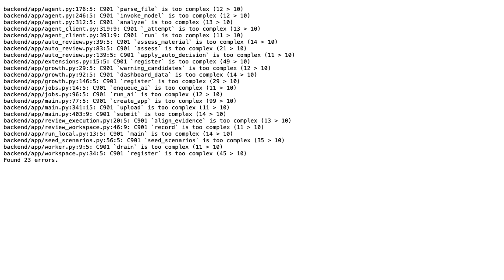
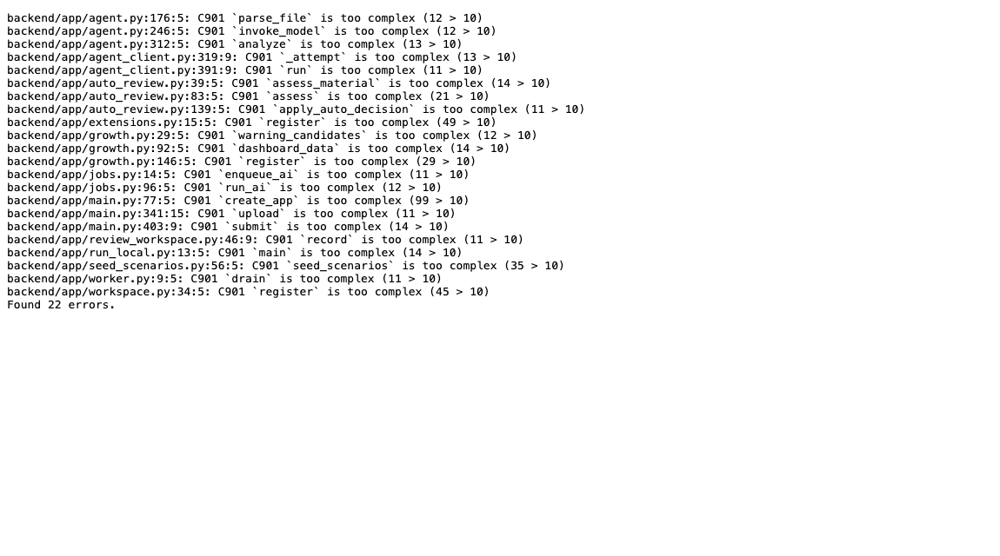

# InnoGrad 代码质量检查报告

**检查日期：2026-11-25。** 本轮发现并修复了一个材料审核缺陷：同一批引文中，若第一条可自动校正、第二条无法核实，旧代码会报错，但第一条已经被改写。修复后，整批校验通过才写回；引文对齐主函数的圈复杂度从 **13 降至 9**，后端 **134 项测试通过**。

## 1. 检查范围和方法

按课程[第 171 页](https://bettermorn.github.io/IntelligentSWEPractice/courseware/171)先扫描、补测试、再重构和复扫；按[第 172 页](https://bettermorn.github.io/IntelligentSWEPractice/courseware/172)整理质量汇报。两轮均扫描 `backend/app` 的 Python 业务代码，不含前端、迁移、测试、第三方依赖和运行数据。人工评审重点是影响审核结果可追溯性的引文校验路径，而不是按函数长度选题。

## 2. 同口径扫描结果

| 指标 | 重构前 | 重构后 | 统计口径 |
|---|---:|---:|---|
| 静态 Bug 类告警 | 0 | 0 | Pylint 未定义变量、赋值前使用；不代表没有业务缺陷 |
| 本轮由测试确认、尚未修复的缺陷 | 1 | 0 | 仅指“校验失败后输入被部分改写” |
| Code Smell 告警 | 27 | 24 | Pylint：局部变量过多 19→18；未显式保留异常原因 8→6；重复代码告警 0→0 |
| 圈复杂度超过 10 的函数 | 23 | 22 | Ruff C901；与上一行分开计，不合并去重 |
| `align_evidence` 圈复杂度 | 13 | 9 | 同一 Ruff McCabe 算法；后端最高值仍为 `create_app` 的 99 |
| 重复行率 | 0.000% | 0.000% | Pylint 相似行检测，最小相似行参数为 4；不排除逻辑相似但写法不同 |

**扫描截图（原始输出）：** 图中 `Found … errors` 是 Ruff 对规则命中总数的表述，本次命中均为复杂度告警，并非运行错误。

重构前：23 处超阈值，包含 `review_execution.py:20` 的 `align_evidence`。



重构后：22 处超阈值，`align_evidence` 不再出现，其他热点仍可见。



[Pylint 原始报告：重构前](evidence/pylint-before.txt) · [重构后](evidence/pylint-after.txt)；[Ruff 原始报告：重构前](evidence/ruff-before.txt) · [重构后](evidence/ruff-after.txt)。

## 3. 本轮优先处理的五项问题

以下按审核路径的业务影响排序；不是全项目复杂度排行榜。第 2、3 项是同一个函数上的不同告警，第 4、5 项发生在不同异常路径。

| 优先项 | 重构前 | 实际修改及结果 |
|---|---|---|
| 1. 失败时部分写回 | 循环内直接更新 `check.evidence[index]`，全批结束才判断是否报错 | 暂存已验证的修正；有问题则报错，不改输入；全部通过才写回 |
| 2. 匹配流程分支过多（C901） | 对齐、查找、消歧和写回挤在主循环，圈复杂度 13 | 提取 `_matching_quotes`，保留同文件搜索、空白归一和原文偏移映射；主函数降至 9 |
| 3. 主函数状态过多（R0914） | 21 个局部变量，同时维护位置、候选和校正结果 | 用 `_unique_candidate` 封装候选去重和原位置优先规则；该函数的 R0914 告警消失 |
| 4. 输出格式错误难以溯源（W0707） | 模型输出不符合结构时，转换异常未显式指定原因 | 使用 `raise … from exc`，仍对调用者返回 `OUTPUT_INVALID` |
| 5. 规则或证据错误难以溯源（W0707） | 规则检查失败也未显式指定原因 | 同样保留原异常链；已有业务错误码及结构化诊断不变 |

[实际源码差异：重构前后逐行对比](evidence/refactor.diff) · [代码评审与遗留问题](code_review.md)。

## 4. 测试与复现

先运行原有专项测试（23 项通过），再补两项：① 一条引文可校正、另一条无匹配，失败后输入不变；② 两页都有匹配，优先采用所报页并保留原文换行。修改业务代码前为 [1 失败、24 通过](evidence/tests-before.txt)，失败的正是第一项；修改后为 [25 通过](evidence/tests-after.txt)。最后运行[后端全量测试](evidence/tests-backend.txt)：134 通过、1 条依赖弃用警告。未据此推断线上模型、浏览器或生产部署已完成验收。

在便携版根目录、已安装项目测试依赖的环境下执行（扫描工具版本：Pylint 4.1.4、Ruff 0.11.13）：

```sh
pylint --rcfile=docs/software/evidence/pylintrc backend/app
ruff check --isolated --no-cache --select C901,F821 --output-format concise backend/app
ruff check --isolated --no-cache --select C901 --config 'lint.mccabe.max-complexity=0' backend/app/review_execution.py
.venv/bin/python -m pytest -q backend/tests/test_review_execution.py
.venv/bin/python -m pytest -q backend/tests
```

第三条命令临时把阈值设为 0，用于显示具体复杂度，不计入告警总数。本轮未改写原发布包和校验清单；如重新分发，应针对新版本重新打包、生成清单。
