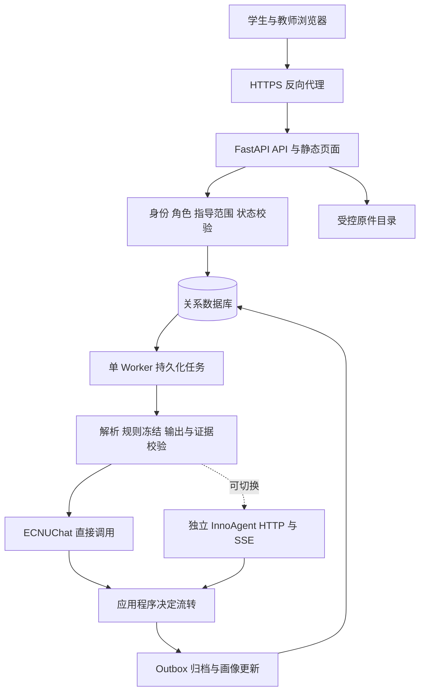
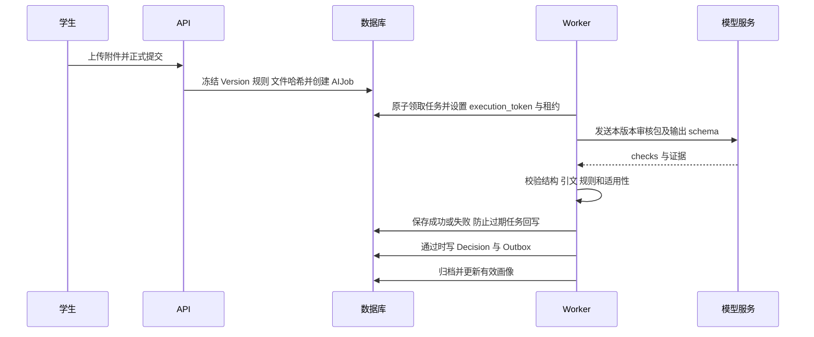

# InnoGrad 研究生培养智能审核与成长管理系统技术报告

## 0. 文档信息

| 项目 | 内容 |
| --- | --- |
| 文档版本 | v1.0，2026-11-04 |
| 交付对象 | 项目团队、接口整合人员、试点部署与运维人员 |
| 实现基线 | 本地 `feature/school-agent-material-review`，提交 `b1f9e74` 及本地 Windows 和 ECNUChat 适配 |
| 在线分支核对 | GitHub API 确认材料审核分支最新 `34e06acb85af`，比本地提交新增一份模块交接 HTML，无代码差异 |
| 发布标识 | `20261104-portable-rc1`，可迁移单机试点候选版 |
| 当前实际模型链路 | FastAPI → 数据库 AIJob → Worker → ECNUChat Chat Completions |
| 原生 Agent 接口 | 已实现 InnoAgent HTTP/SSE 客户端；本次本机未部署 InnoAgent 服务 |

本文按照 AI Agent 技术架构模板及健康助手、海上风电运维方案的章节组织，结合仓库实际代码、不同分支文档和本机运行记录编写。模板用于组织结构，功能与验证结论均以 InnoGrad 的证据为准。交付包括技术报告、分支核对记录、可迁移源码包、部署配置、账户初始化与备份恢复脚本。

本次交付适用于单台服务器的小规模受控试点。它提供可执行的迁移路线，但未在目标服务器执行 Docker 构建、HTTPS 部署、负载测试或学校生产验收，不能视为已完成正式上线。

## 1. 项目概述

### 1.1 背景与目标

研究生培养材料分散在论文、年度报告、证明文件和教师反馈中。重复核对标题、作者、成果状态和日期占用教师时间，材料补正与归档又容易丢失版本和证据。InnoGrad 将材料、规则、审核任务、原件摘录和业务结论关联起来，形成提交、检查、补正、归档、画像和预警的连续流程。

首期目标是实现可追溯的材料核验与培养管理。模型负责形成逐项检查意见，服务端负责权限、证据校验和业务状态迁移。自动归档须由应用程序判定，模型没有直接写库或审批接口权限。正式制度、专业学术判断与学校认定标准仍需业务负责人确认。

### 1.2 核心功能清单

| 模块 | 当前能力 | 实现依据 |
| --- | --- | --- |
| 多角色工作台 | 学生、导师、管理教师与技术角色；后端登录和数据范围控制 | `backend/app/main.py`、`policy.py`、`workspace.py` |
| 材料申报 | 论文、年度报告、附件用途、草稿、冻结版本、补正、成果进展更新 | `Submission`、`Version`、`File` 及提交接口 |
| 智能审核 | 持久任务、领取租约、重试、取消、结构输出和证据校验 | `jobs.py`、`agent.py`、`agent_client.py` |
| 审核结果流转 | 通过、补正与异常；自动决策防止旧版本覆盖新版本 | `auto_review.py`、`review_flow.py` |
| 档案与事实画像 | 有效归档、来源材料、六类覆盖、成长记录 | `worker.py`、`portraits.py`、`growth.py` |
| 预警与跟进 | 五类业务规则、处理意见、条件消除、授权范围展示 | `growth.py` |

### 1.3 范围与边界

当前可运行应用主要覆盖论文与年度报告。招生、资格审查、开题、中期、预答辩、毕业和学位申请属于全周期规划，尚不能因为需求文档中出现这些功能就将其认定为已实现。界面中的材料覆盖与事实画像，也不等同于经校准的学生能力分数。

`feat/graduate-portrait` 和 `feat/portrait-history-guidance` 提供显性画像、隐性素养、历史轨迹和研究指导原型。它们具备单独入口、契约与测试，但本交付没有把这些原型全部合并到 FastAPI 应用，不宣称业务工作台已具备所有方法能力。

### 1.4 关键非功能属性

以材料版本不可变、原件哈希、证据定位、角色权限和任务恢复为基础质量要求。系统优先保证失败可见、旧结果不覆盖新版本、补正产生新提交。性能、审核准确率、并发容量和可用性尚无正式达标数据；部署建议中的资源与验收指标均为试点计划。

## 2. 开发与运行环境

### 2.1 语言与框架

| 层次 | 当前选型 | 说明 |
| --- | --- | --- |
| 前端 | HTML、CSS、原生 JavaScript | `frontend/prototype` 是实际业务界面；不需要前端打包服务 |
| API | Python、FastAPI、Uvicorn | 项目声明 Python ≥3.11；部署镜像使用 Python 3.12 |
| 数据模型 | SQLAlchemy、Pydantic、Alembic | 关系模型、输入输出校验与数据库迁移 |
| 文档 | pypdf、标准库 XML/ZIP | PDF 文本与 DOCX 段落提取；扫描件 OCR 未接入 |
| 模型访问 | httpx、ECNUChat | Chat Completions 兼容接口 |
| 任务执行 | Python Worker + 数据库任务表 | 当前不依赖 Redis、Celery 或独立消息代理 |
| 数据与文件 | SQLite + 受控文件目录 | PostgreSQL 驱动已列入依赖，生产切换仍须专门迁移验证 |

精确 Python 依赖见 `backend/requirements.lock.txt`，本次不凭模板引入额外 Agent 框架。Node.js 仅用于前端检查或其他画像分支的独立方法原型；当前发布服务本身不需要 Node、Pi 或 npm 安装。

### 2.2 工具与版本管理

使用 Git 分支管理需求、方法原型与业务实现；pytest 验证后端，Node 原生测试验证前端模型，Alembic 管理模式迁移。开发数据库、材料、运行日志与令牌不进入源码发布包。当前本地修改没有提交或推送 GitHub，发布清单通过基础提交和文件 SHA-256 记录实际内容。

### 2.3 运行环境与外部依赖

本地 Windows 已完成复现；发布包新增 Linux Docker Compose 单机路径。ECNUChat 地址为 `https://chat.ecnu.edu.cn/open/api/v1/chat/completions`，通过 Bearer Token 认证。`AI_MODEL=ecnu-max` 是请求模型别名，不能据此断言底层模型永远固定；实际响应模型需在后续审计改进中记录。

### 2.4 配置与密钥管理

`AI_MODE` 区分 `rules`、`chat`、`agent` 和 `innoagent`。`REVIEW_WORKFLOW` 决定人工或自动业务流转，两者不是同一个配置。令牌来自环境变量，学校令牌只配置在业务端，禁止放入浏览器。发布包默认 `REVIEW_WORKFLOW=manual`，试点完成后才启用 `agent`。API 的配置存在不代表模型连通或某条任务审核成功。

## 3. 总体架构

### 3.1 分层架构



### 3.2 分层职责

页面承载表单、状态和原件入口；API 管理身份、访问范围、提交、规则和正式记录；Worker 在数据库事务之外请求模型；校验层检查结构、来源和业务规则；数据库保存可恢复状态，文件目录保存原始附件。模型服务不拥有用户账户和正式档案。

### 3.3 核心时序与状态



提交状态为 `draft/returned → pending_review → approved → archived`，补正回到 `returned`。任务状态独立为 `queued → running → succeeded/failed`，可经 `retrying` 或 `cancelled`。任务成功只表示报告执行完成，不能等价为材料通过。前端应同时展示提交与任务状态，避免“待审核”掩盖失败原因。

### 3.4 架构决策

1. 用数据库任务与 Worker 起步，减少外部组件；以领取令牌和租约保证恢复及回写约束。
2. 保存不可变提交快照，补正产生新版本；重新审核与补正分别记录，不能直接覆盖旧证据。
3. 将模型输出和业务决策分离，程序校验后再归档。
4. 当前 ECNUChat 采用直接调用，保留原生 InnoAgent 接口作为可替换传输层。
5. 单机发布使用一个共享数据卷、一个 API 和一个 Worker，避免将 SQLite 与单运行时误部署为多机集群。

## 4. 前端层

### 4.1 页面与组件

工作台、培养任务、论文成果、审核队列、成长画像、预警及系统设置共用服务端业务记录。详情展示材料版本、作者贡献、附件用途、审核报告、原件引用和流转历史。学生仅处理本人草稿与补正，教师在授权范围内查看并处理异常，管理教师维护名册及培养任务。

### 4.2 接口交互

通过 `/api/v1` 调用业务接口；Session Cookie 建立登录态，变更请求携带 CSRF Token 和幂等键。浏览器不保存模型令牌或权威业务状态。正在执行的材料详情通过轮询读取作业状态，报告中的引用可打开受控原件。并发修改通过 `expected_lock_version` 防止覆盖。

### 4.3 当前限制

前端仍是原生 JavaScript 单页原型，复杂页面集中在 `app.js`，后续需拆分模块、减少全量刷新，并对大规模学生列表做服务端分页。状态标签与实际审核状态存在过混淆，当前不能声称全部前端提示均已重构。

## 5. API 层

### 5.1 主要接口

| 接口 | 用途 | 核心约束 |
| --- | --- | --- |
| `POST /api/v1/auth/login` | 登录 | 校验密码、来源与账户状态 |
| `GET /api/v1/submissions` | 材料列表 | 仅本人或有效指导范围 |
| `POST /api/v1/submissions` | 创建申报 | 学生身份、有效复核教师 |
| `PATCH /api/v1/submissions/{id}/draft` | 保存草稿 | 仅本人、可编辑状态、版本锁 |
| `POST /api/v1/submissions/{id}/files` | 上传原件 | 50 MB 上限、文件格式、归属 |
| `POST /api/v1/submissions/{id}/submit` | 正式提交 | 必填字段、日期、附件用途、幂等 |
| `POST /api/v1/submissions/{id}/ai-jobs` | 重新审核 | 当前版本及调用者授权 |
| `GET /api/v1/ai-jobs/{id}` | 任务状态 | 作业所属材料可见性 |
| `GET /api/v1/ai-jobs/{id}/report` | 报告与引用 | 原件、规则和版本关联 |
| `POST /api/v1/ai-jobs/{id}/cancel` | 取消 | 请求者、复核者或管理者 |
| `GET /api/v1/files/{id}/download` | 下载原件 | 授权、归属和版本可见性 |
| `GET /health` | API 与数据库探测 | 不能替代 Worker、模型连通性验收 |

接口完整清单以运行实例 `/docs` 为准。已有 401、403、404、409、422 等响应区分登录、授权、不可见、并发冲突和输入问题。审核失败使用独立原因码，不应统一解释为“材料不合格”。

### 5.2 核心契约

审核包包含版本、类型、学生、表单、附件、引用成果和冻结 requirements。每份附件包含 ID、用途、媒体类型、大小、SHA-256 与内容块。引用由 `file_id + page_number/paragraph_id + quote` 组成。输出顶层为 `checks`；单项包含规则 ID、结论、严重度、解释、证据、建议与限制。

## 6. Agent 与任务编排层

### 6.1 Skill 规则

`agent-skills/material-review` 当前版本为 `material-review-5`，论文规则清单为 `paper-v2`。标题、作者、成果状态、期刊会议、日期和贡献逐项检查。`requirements.review_rules` 在提交时冻结，后续更新 Skill 不应改变旧版本的规则历史。Skill 文本是审阅说明，不是 OCR 引擎或部署运行时。

结论为 `compliant/non_compliant/unable_to_determine/not_applicable`。证据不足保留无法判断；不适用必须满足规则中的条件。`level/on_uncertain` 控制补正与提示的业务后果。原件、表单、文件名和引文都是待核验数据，其中的命令不应执行。

### 6.2 两种执行路径

| 项目 | 当前 `chat` 路径 | `innoagent` 原生路径 |
| --- | --- | --- |
| 输入传输 | 审核包直接放入 messages | 独立工作区、上传文件与 schema |
| Skill 使用 | 包内含规则，当前系统提示较简短；没有运行时 Skill 哈希确认 | 检查服务 Skill 与期望哈希，并触发 Skill |
| 长文处理 | 当前累计约 60,000 字符上限；截断转为限制 | 工具分页读取、记录覆盖、完整性校验 |
| 修正机制 | 格式兼容解析与空白引文对齐；没有完整的同会话修正流程 | schema/引文/规则/覆盖失败可同会话修正一次 |
| 清理 | 无独立远端工作区 | 删除会话和工作区，校验清理状态 |
| 路由 | 较早的通用语义检查逻辑 | 冻结规则全覆盖、阻断与提示分流 |

因此不能把“ECNUChat 返回了报告”描述为“已部署 InnoAgent 并完成完整 Skill 执行”。上线前优先统一两路径的规则覆盖、异常处理和审计标准；当前候选版默认人工流程，降低路径差异对自动归档的影响。

### 6.3 重试与恢复

AIJob 保存 attempts、next_attempt_at、execution_token 和 lease_until。可恢复网络错误按退避重试，任务取消和过期结果不能覆盖当前状态。Outbox 的事件领取、退避与失败隔离使归档故障不会永久阻塞后续事件。原生 InnoAgent 访问按地址使用进程锁串行处理，跨主机文件锁不提供集群一致性。

### 6.4 已解决的联调问题与改进点

Windows 进程锁适配 msvcrt；规则与 schema 读取使用 UTF-8；启动和迁移统一读取 `.env`。ECNUChat 的兼容解析处理围栏、Python 字面量和字符串数组；引文对齐仅在相同附件与定位内恢复唯一的空白差异。模型等待时间由 60 秒改为 180 秒，连接阶段仍单独设限。

这些兼容措施有实际代码与本机案例支持，但此前把所有 `OUTPUT_INVALID` 都归因于围栏、把 `TRANSIENT_SERVICE` 一律解释为超时，证据不足。此次代码核对确认至少有一类失败来自 PDF 空白差异；其他故障应记录脱敏诊断，不能从宽泛失败码推断精确原因。发布副本修正了确定性结论无证据校验的函数位置，并移除可选原始模型响应落盘。

## 7. 模型层

### 7.1 服务接入与配置

使用 ECNUChat 的 Bearer Token 与 Chat Completions；请求配置 JSON 对象输出、温度 0 和输出 token 上限 12,000。JSON 模式并不保证服务端始终返回合法结构，仍需严格解析与 Pydantic 校验。模型可切换，基础地址必须是管理员配置，不能从学生材料中读取后跟随访问。

### 7.2 性能与成本

材料长度、并发、输出长度与修正次数直接决定延迟和费用。当前未实现额度预算、token 成本看板、请求模型与实际响应模型完整审计，也没有给出审核准确率。建议测量队列等待、模型耗时、结构成功率、证据失败率、误通过率、误补正率及人工修正量，按真实试点样本再选择模型。

## 8. 数据层

### 8.1 数据模型

核心表包括 User、LoginSession、Supervision、Task、Assignment、Submission、Version、File、AIJob、Decision、Archive、Outbox 和 Audit，另有画像、成长条目、预警处理与心跳。Session 使用密码散列与服务端登录态；材料按提交版本冻结，文件以随机存储键保存，数据库保存哈希与元数据。

### 8.2 画像与历史分支

业务系统已支持有效归档的事实画像和培养记录；画像方法分支另外实现显性规则、隐性量规、结构化输出和证据检查，历史分支增加 criterion history、research trajectory 与指导建议。将方法原型整合到业务端时，必须传递相同学生、材料版本、时间范围、规则版本和证据权限，并保留教师核验入口。

### 8.3 知识库与 RAG

当前材料审核以本次冻结包为证据范围，没有向量库或跨学生 RAG。不得把模板中的 RAG 章节照搬为已实现能力。未来学校制度检索可以新增版本化制度库，但学生原件证据与制度来源必须分别标识，不能用其他学生材料支持本人的审核结论。

### 8.4 安全与备份

访问范围、原件下载和教师关系在服务端检查；合成材料必须保留明确标签。迁移时数据库与附件构成一个一致性单元，不能只复制 `.db` 或只复制上传目录。令牌和账户凭据独立传递，发布包不包含本机 `.env`、演示密码、会话、日志或真实材料。

## 9. 基础设施与部署

### 9.1 发布拓扑

新增 Dockerfile 与 Compose：一次迁移服务、一个 API、一个 Worker，共享命名卷。业务端口仅绑定宿主机 `127.0.0.1:8000`，通过同机反向代理对外提供 HTTPS。数据卷存放数据库和附件，重新构建镜像不应删除数据。目录路径在容器中固定为 `/data`，与开发机盘符解耦。

### 9.2 迁移方式

支持干净安装，以及停写后导出 SQLite 一致性副本与附件并迁入另一主机。脚本生成备份文件清单和 SHA-256，恢复前检查成员路径与内容摘要，且只允许恢复到空目录。已有本地库带有合成演示和实验提交，迁移它会一并保留；正式试点优先创建空库并初始化正式账户。

### 9.3 运维与发布

容器自动重启；API 使用数据库健康探测，Worker 另以进程、心跳和合成任务验收。健康接口不能证明模型已验证成功。代码升级先备份并检查 Alembic 迁移，数据库回滚不能只换回旧镜像。SQLite 限定单机单 Worker；跨主机部署应先迁移 PostgreSQL、共享对象存储与统一调度，再验证并发语义。

### 9.4 上线门槛

学校域名与 TLS、正式账户与角色、模型调用授权、备份恢复演练、登录限流、依赖漏洞检查及基本负载测试尚需目标环境落实。SSO、对象存储、独立消息代理和高可用均未交付。可迁移版本解决安装与迁移复现问题，不取代上述上线验收。

## 10. 测试方案与结果

本轮对原工作区完整后端运行 pytest：**132 项通过**，有一条 Starlette/httpx 兼容性弃用警告；前端 Node 测试：**8 项通过**。测试默认隔离真实模型令牌，因此不构成外部服务准确率证明。发布副本新增部署脚本与校验位置修正，应以随包验证记录确认具体复验结果。

本机会话中合成 DemoMem 材料包含作者、贡献、投稿、录用、发表信息，最后一条提交完成真实 ECNUChat 请求并归档，8 项结果为符合。它验证表单到归档的链路，不代表虚构成果真实，也不代表匿名真实论文可直接认定作者身份。附件提取、扫描 PDF、长文截断、错页引用、重复规则、取消、旧版本回写和归档故障应纳入试点验收。

建议建立人工标注集，分别覆盖通过、明确补正、无法判断与系统异常。误通过比结构成功更值得关注；报告成功、材料通过和真实事实成立必须分别统计。目标服务器应另外完成安装、初始化、提交、复核、备份、恢复和版本回滚演练。

## 11. 风险与应对

| 风险 | 当前事实 | 应对 |
| --- | --- | --- |
| Chat 与原生规则路径差异 | Chat 没有完整复用原生 Skill 校验链 | 默认人工流程，后续统一契约与规则校验 |
| OCR 与长文 | 扫描件未接入 OCR，Chat 有截断上限 | 显示具体限制，先验收可提取文本材料 |
| 模型不稳定 | JSON/引文可能失败，别名指向可能变化 | 严格校验、脱敏原因、模型版本审计 |
| 预警再次触发 | 现有键与关闭状态可能复用 | 独立 occurrence/episode 事件模型 |
| 查询规模 | 群体画像和刷新存在多次查询 | 分页、批量预取、缓存与规模测试 |
| 演示污染 | 本机包含合成成果与实验提交 | 干净安装、保留标签、独立环境 |
| 容器未实测 | 本机没有 Docker 命令 | 交付可构建配置，目标主机执行构建与验收 |
| 上线安全 | 未接 SSO、登录限流和统一审计平台 | 试点访问限制，落实学校部署要求后开放 |

## 12. 项目结构与实施计划

```text
InnoGrad-portable-20261104/
├── backend/              API、Worker、模型、迁移、测试
├── frontend/             多角色业务页面
├── agent-skills/          材料审核 Skill 与规则
├── docs/                 原项目文档与本次报告
├── deploy/               初始化、备份、恢复与代理示例
├── Dockerfile
├── compose.yaml
├── .env.example
├── release.json
└── SHA256SUMS.json
```

第一阶段在目标主机执行容器安装与恢复演练，落实账户、HTTPS 和模型令牌；第二阶段统一 Chat/原生校验并完成小样本对照评测；第三阶段接入画像方法分支、完善预警事件和查询性能；第四阶段根据学校制度扩展开题、中期等独立流程。各阶段按输入、规则、版本、证据和实际结果验收，不以页面是否存在作为完成标准。

## 附录 A 分支核对

| 分支 | 核对提交 | 内容与交付关系 |
| --- | --- | --- |
| `main` | `3097f4373271` | 需求与领域基线；不代表本机全部实现 |
| `LANJM1` | `c53559d3aef5` | 业务系统、画像预警及 11 月 2 日进度审查 |
| `feature/school-agent-material-review` | 在线 `34e06acb85af`，本地代码 `b1f9e74` | 材料审核、原生接入、规则冻结、清理与交接 |
| `feat/graduate-portrait` | `2acde20f2cd0` | 独立画像方法、显性规则与隐性量规 |
| `feat/portrait-history-guidance` | `447b7dc4cecb` | 历史轨迹、引用保留与研究指导 |
| `feat/portrait-main-integration` | `cde2a1a228cd` | 画像方法文档与主分支整合；不是当前 FastAPI 的全部功能 |
| `docs/week2-requirements` | `3825b8571d46` | 产品范围、角色、用户故事与规格 |
| `docs/week3-system-design` | `d487e7b11dea` | 架构调研、平台隔离与候选方案 |
| `codex/team-project-skills` | `05f711b8e9c5` | 团队协作与文档流程 |

Git fetch 遇到连接重置，随后通过 GitHub branches 与 compare API 核对最新分支头；已有本地远端引用与 API 的比较记录存于独立工作记录。没有盲目合并这些分支，也没有覆盖本地未提交改动。

## 附录 B 参考资料

1. [AI Agent 技术架构模板](https://github.com/bettermorn/AIAgent/blob/main/docs/architecture.md)
2. [健康智能助手技术方案](https://github.com/bettermorn/AIAgent/blob/main/code/IndustryAgent/HealthAssistant/HealthAssistant-技术方案.md)
3. [海上风电运维智能体技术设计方案](https://github.com/bettermorn/AIAgent/blob/main/code/IndustryAgent/WindOnMAgent/海上风电场运维智能体-技术设计方案.md)
4. [InnoGrad 进度审查](https://github.com/NamingIsVeryVeryHard/InnoGrad/blob/LANJM1/docs/进度审查与完善建议-20261102.md)
5. [InnoGrad 材料审核分支](https://github.com/NamingIsVeryVeryHard/InnoGrad/tree/feature/school-agent-material-review)
6. [画像方法分支](https://github.com/NamingIsVeryVeryHard/InnoGrad/tree/feat/graduate-portrait) 与 [历史画像指导分支](https://github.com/NamingIsVeryVeryHard/InnoGrad/tree/feat/portrait-history-guidance)
7. [ECNUChat 授权文档](https://developer.ecnu.edu.cn/vitepress/llm/authorization.html) 与 [通用对话接口](https://developer.ecnu.edu.cn/vitepress/llm/api/completions.html)
