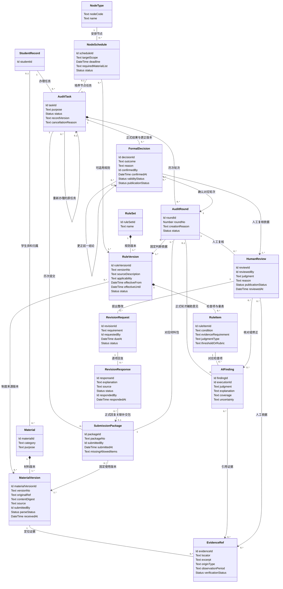

# 软件系统功能规格说明书

关联反馈：[提交功能和非功能需求规范（#12）](https://github.com/NamingIsVeryVeryHard/InnoGrad/issues/12)。角色、功能树、详细需求和领域模型分别对应 [W2-01（#4）](https://github.com/NamingIsVeryVeryHard/InnoGrad/issues/4) 至 [W2-04（#7）](https://github.com/NamingIsVeryVeryHard/InnoGrad/issues/7)。

**状态：需求草案，待业务评审，功能尚未实现。** 本文按课程要求的功能规格书结构，汇总同一组草案。叶子功能的输入、处理、输出和验收场景见[功能需求](functional_requirements.md)，不在本文重复展开。

## 0. 文档信息

| 项目 | 内容 |
| --- | --- |
| 系统名称 | InnoGrad，研究生全培养周期智能审核与成长管理系统 |
| 版本 | 第二周需求草案 |
| 适用范围 | 学生端与管理端。管理端是重点，学生端提供本人材料、整改、进度、提醒和反馈入口 |
| 编号 | 用户 ACT-x，功能 FR-x.y，非功能 NFR-x，边界外协作方 SYS-x |
| 详细文档 | [系统角色](actors.md)、[功能树](feature_tree.md)、[功能需求](functional_requirements.md)、[非功能需求规范](nonfunctional_spec.md)、[UML 领域模型](../software/domain_model.md) |

正式审核、资格和评选结论由获授权人员确认。AI 初审和模型推断只作为辅助意见，不能直接成为正式结果。

## 1. 系统角色 (Actor)

| 编号 | Actor | 入口 | 主要职责 |
| --- | --- | --- | --- |
| ACT-01 | 学生 | 学生端 | 按申请或在读阶段准备、提交和补交本人材料，查看已发布反馈、进度、画像与成长建议 |
| ACT-02 | 导师 | 管理端 | 查看指导范围内学生的进展和证据，提供指导与评价，并按额外授权参与复核或帮扶 |
| ACT-03 | 审核与培养管理人员 | 管理端 | 按分别授予的能力接收材料、核对证据、复核、整改、确认结果，并组织规则、招生、评奖、监测、匹配和帮扶 |

申请和在读是学生的业务阶段，不另设 Actor。复核、任务组织、规则发布、正式确认和审计是不同授权；只具备其中一项时，不能默认执行其他操作。服务端检查每次操作的身份、能力和数据范围。

| 编号 | 边界外协作方 | 边界 |
| --- | --- | --- |
| SYS-01 | Inno-Agent 及模型服务 | 只处理本次任务获授权的数据和规则，返回待核验的辅助结果，没有确认权 |
| SYS-02 | 已获批准的数据来源与通知渠道 | 课程、成果或消息能力尚未确认接通，不作为当前已接入系统 |

权限矩阵、越权场景和待确认的岗位分离要求见[系统角色与权限](actors.md)。

## 2. 功能树 (Feature Tree)

共 51 项叶子功能。管理端和公共能力使用 FR-1 至 FR-10，学生端专属能力使用 FR-11。两端共用同一次提交、复核和归档记录，不另建一套审核流程。

```text
InnoGrad 管理端
├── FR-1 身份、权限与操作记录
│   ├── FR-1.1 建立业务身份与授权范围
│   ├── FR-1.2 检查操作和数据访问权限
│   ├── FR-1.3 记录与查询操作审计
│   └── FR-1.4 查看业务记录的来源与处理历史
├── FR-2 培养规则与评价依据
│   ├── FR-2.1 维护规则及评价量表草稿
│   ├── FR-2.2 发布、停用与选择规则版本
│   ├── FR-2.3 配置培养节点、材料清单和截止事项
│   └── FR-2.4 配置与校验评价 Skills
├── FR-3 培养节点智能审核
│   ├── FR-3.1 招生审核
│   ├── FR-3.2 年度报告审核
│   ├── FR-3.3 资格审查
│   ├── FR-3.4 开题审查
│   ├── FR-3.5 中期审查
│   ├── FR-3.6 预答辩审查
│   └── FR-3.7 论文形式审查
├── FR-4 材料与数据接收
│   ├── FR-4.1 接收材料并保存版本
│   ├── FR-4.2 解析材料、定位证据并处理识别失败
│   └── FR-4.3 正式提交材料包
├── FR-5 智能审核中心
│   ├── FR-5.1 创建与组织审核任务
│   ├── FR-5.2 分配复核与确认职责
│   ├── FR-5.3 执行初审并生成辅助意见
│   ├── FR-5.4 查看任务、规则与证据
│   ├── FR-5.5 记录人工复核及意见修正
│   ├── FR-5.6 退回整改与补交材料
│   ├── FR-5.7 再次核验补交材料
│   └── FR-5.8 确认正式结论并归档
├── FR-6 学生全周期档案
│   ├── FR-6.1 维护学生主档与培养计划
│   ├── FR-6.2 汇集课程、成果与实践记录
│   ├── FR-6.3 关联节点结果和历次处理记录
│   └── FR-6.4 查询档案并提交更正请求
├── FR-7 成长画像
│   ├── FR-7.1 形成可核验成果账本
│   ├── FR-7.2 形成有证据的能力评价
│   ├── FR-7.3 展示成长轨迹与待关注变化
│   └── FR-7.4 复核画像、处理反馈并保留修正版本
├── FR-8 培养指导与协作
│   ├── FR-8.1 查看负责学生的进展与证据
│   ├── FR-8.2 记录指导意见与阶段目标
│   └── FR-8.3 跟踪帮扶行动和后续变化
├── FR-9 学院培养管理
│   ├── FR-9.1 招生候选筛选与导师匹配
│   ├── FR-9.2 评奖评优资格核验与候选评选
│   ├── FR-9.3 监测培养计划偏差
│   ├── FR-9.4 核实预警与组织帮扶
│   ├── FR-9.5 项目人才匹配
│   └── FR-9.6 形成资源配置参考
└── FR-10 智能体接入与结果核验
    ├── FR-10.1 执行限定业务目的与数据范围的智能体任务
    ├── FR-10.2 配置与替换模型接入
    └── FR-10.3 核验辅助结果并处理执行异常
```

```text
InnoGrad 学生端
├── 材料与整改
│   ├── FR-4.1 上传本人材料并保存版本
│   ├── FR-4.3 正式提交本人材料包
│   ├── FR-11.1 提交前智能预审
│   └── FR-5.6 查看已发布整改要求并补交
├── 进度与提醒
│   ├── FR-11.2 查看培养进度与下一步事项
│   └── FR-11.3 查看节点提醒与待办
├── 我的档案与反馈
│   ├── FR-6.2 补充本人成果与实践资料
│   ├── FR-6.4 查看本人档案并提出更正
│   ├── FR-7.3 查看本人成长轨迹
│   ├── FR-7.4 对本人画像提出反馈
│   └── FR-8.2 查看指导意见并反馈
└── 申请与成长建议
    ├── FR-11.4 对照申请条件整理准备清单
    └── FR-11.5 查看有依据的成长建议
```

每项功能对应的入口、Actor 和第一周范围编号见[功能树与范围映射](feature_tree.md)。

## 3. 典型业务流程

以一次培养节点审核为例。具体节点、制度和岗位分工仍待业务确认。

1. 获授权的管理人员选择适用学生、规则版本和材料要求，并组织审核任务。
2. 学生查看准备清单，提交本人材料；尚未建号时，获授权人员可以接收外部材料并代办，同时保留来源和实际操作者。
3. 系统按本次规则生成初审意见，标明缺项、材料位置和需要专业判断的内容。
4. 获授权的复核人员核对规则和材料，修正初审意见；需要整改时发布补交要求。
5. 学生按已发布反馈补交。相关人员再次核验后，由具有确认权限的人员确认正式结果。
6. 审核、整改和结论进入学生档案。导师和管理人员在授权范围内安排指导或帮扶，学生查看本人结果和下一步事项。

这条流程对应 FR-4、FR-5、FR-6.3 和 FR-11.2。招生、评奖、匹配和监测复用同一组档案与权限规则，不在本文单独展开。

## 4. 领域模型 (Domain Model UML)

下面是规则、材料与审核闭环的核心类图。身份授权、培养档案与画像、机会评选，以及智能体执行，分别见领域模型的其余四节：[UML 领域模型](../software/domain_model.md)。



审核任务固定所使用的材料版本和规则版本。补交形成新的材料版本和审核轮次，正式结论保留确认人、理由和更正关系。类图描述业务概念，不决定数据库表、接口或部署方式。

## 5. 验收摘要

当前只作为需求草案的检查口径，不表示功能已经实现或通过业务验收。

- 三类 Actor 的操作和数据范围能够解释越权操作为什么被拒绝。
- 51 项 FR 均能在功能树、功能需求和范围映射中找到同名条目。
- 沿审核闭环可以关联规则版本、材料版本、人工复核、整改回复和正式结论。
- AI 返回“通过”或材料中要求跳过检查时，结果仍只是待核验意见，不生成正式结论。
- 业务规则、授权岗位、评价依据和试点范围确认前，不把草案写成已定稿。
