# 技术方案调研

关联任务：[第三周总任务 #13](https://github.com/NamingIsVeryVeryHard/InnoGrad/issues/13)。

**状态：第三周调研草案，2026-10-15。** 本周论证可行路线、列出验证问题；第六周结合实验和评审定稿。下文的“建议”均未成为已批准的技术选型，也不代表已经接通服务或达到质量指标。

## 1. 目标与约束

首个调研切片对应[用户故事](../requirements/user_stories.md)的 Release 1：固定材料与规则 → 辅助检查 → 人工复核 → 整改新轮次 → 正式确认与归档 → 本人进度及画像依据。文档暂以年度报告说明流程，实际试点节点待业务确认。

沿用[平台边界](platform_reuse.md)：`apps/web/` 承载学生端与管理端；`apps/server/` 管理权限、业务状态、正式记录和智能体接入。智能体输出只形成辅助意见。角色授权、材料版本和正式结论不能交给聊天历史或模型自行决定。

当前仓库有需求与领域模型，未集成业务后端、数据库或模型。当前先形成用户故事和技术调研文档，交互原型待制作；后续演示应使用虚构数据。

## 2. 复用基础与候选路线

2026-10-15 核对的 [Inno-Agent README](https://github.com/hhyqhh/inno-agent/blob/5be785f8cc0a89394b858c123d60738078a597cb/README.md)说明：平台基于 Pi SDK，提供 Skills、分层记忆、工作区与工具扩展；同时明确一个进程只有一个活动智能体会话，没有多用户并发、鉴权或租户隔离。此次核对版本为 `5be785f8cc0a89394b858c123d60738078a597cb`，已结合公开说明检查与账号和隔离有关的源码，范围见下表；未进行完整安全审计或业务接入实验。

**在线平台另行核验。** [InnoSpark](https://www.innospark.cn/) 在线 Web 有账号菜单、账号管理与退出登录入口，并嵌入独立域名的 Agent Sandbox。它与上述开源运行时不是同一层；开源 README 的限制不能证明在线平台缺少账号鉴权或租户隔离。目前可确认账号与登录态可见，尚未核验用户到沙箱的分配规则、跨账号访问控制、存储/执行隔离、部署版本及集成接口。优先联系平台维护者确认可复用能力，再决定是否新增身份基础设施。

#### 开源源码核对结果

源码核对覆盖上述固定提交的 HTTP 入口、路由分派、会话、画像、工作区、终端 WebSocket 和部署示例。结论限定为该源码版本，不代表线上 InnoSpark 的外层部署。

| 检查项 | 源码证据与结论 |
| --- | --- |
| Web 登录与普通 API 鉴权 | [server.ts](https://github.com/hhyqhh/inno-agent/blob/5be785f8cc0a89394b858c123d60738078a597cb/apps/inno-agent/src/server.ts#L1513)完成日志、懒初始化后直接分派请求；[route-dispatch.ts](https://github.com/hhyqhh/inno-agent/blob/5be785f8cc0a89394b858c123d60738078a597cb/apps/inno-agent/src/server/route-dispatch.ts)按 URL 前缀选处理器，没有建立用户身份或检查账号令牌的公共层。Web 未实现在线账号登录 |
| 会话与记忆归属 | [sessions.ts](https://github.com/hhyqhh/inno-agent/blob/5be785f8cc0a89394b858c123d60738078a597cb/apps/inno-agent/src/server/routes/sessions.ts#L306)枚举进程数据目录中的会话；[learner.ts](https://github.com/hhyqhh/inno-agent/blob/5be785f8cc0a89394b858c123d60738078a597cb/apps/inno-agent/src/server/routes/learner.ts#L57)读写同一个画像目录；[runtime.ts](https://github.com/hhyqhh/inno-agent/blob/5be785f8cc0a89394b858c123d60738078a597cb/apps/inno-agent/src/runtime.ts#L126)将 learner、sessions、l2、l3 统一从进程级 dataDir 派生，没有按请求用户或租户分区 |
| 工作区与文件 | [WorkspaceMeta](https://github.com/hhyqhh/inno-agent/blob/5be785f8cc0a89394b858c123d60738078a597cb/apps/inno-agent/src/workspace/workspace-registry.ts#L10)记录 ID、名称和路径，未记录所有者或租户；[文件路由](https://github.com/hhyqhh/inno-agent/blob/5be785f8cc0a89394b858c123d60738078a597cb/apps/inno-agent/src/server/routes/workspaces.ts#L329)校验真实路径留在所选工作区内，没有调用者与工作区归属校验。路径防越界不能替代用户间隔离 |
| 终端 WebSocket | [upgrade 入口](https://github.com/hhyqhh/inno-agent/blob/5be785f8cc0a89394b858c123d60738078a597cb/apps/inno-agent/src/server.ts#L1610)检查服务初始化、URL 与终端是否存在，随后升级连接；此处没有账号令牌、用户或租户归属检查 |
| 已有工具权限与沙箱 | [权限与沙箱说明](https://github.com/hhyqhh/inno-agent/blob/5be785f8cc0a89394b858c123d60738078a597cb/docs/PERMISSIONS_AND_SANDBOX.md)区分工具审批和 OS 执行限制，沙箱需显式开启；这些机制不实现 Web 账号权限。微信扫码与 bridge 令牌用于 IM 渠道，也不能作为普通 Web API 鉴权证据 |
| 示例部署 | [docker-compose.yml](https://github.com/hhyqhh/inno-agent/blob/5be785f8cc0a89394b858c123d60738078a597cb/docker-compose.yml)为一个服务挂载一组 config/data/skills/workspace；未提供按账号分配实例或租户路由的部署层 |

本次为静态调用链审查，未安装依赖、启动上游服务或进行跨账号渗透测试。现有证据足以判断该仓库没有内建的在线账号与多租户业务隔离；InnoSpark 的登录、实例分配及隔离机制仍须向平台维护者核验。

| 路线 | 适用性与收益 | 代价与待验证问题 | 本周建议 |
| --- | --- | --- | --- |
| InnoSpark 平台能力 + Inno-Agent / Pi SDK + 业务状态机 | 优先复用在线账号与沙箱能力，延续 Skills；人工作业与正式结论由业务服务管理 | 需核验在线账号和沙箱接口、部署版本、授权传递、取消、恢复与输出结构；不能仅据开源限制判断线上能力 | 优先做可行性实验，封装可替换适配层 |
| LangGraph + 业务服务 | 适合需要明确步骤、长任务恢复和人工中断的运行编排 | 增加运行状态与业务状态的同步、持久化和运维工作；仍须自己实现业务授权 | 作为恢复能力不足时的对照路线 |
| LangChain Agent / CrewAI / AutoGen 等 | 可用于工具循环或角色协作实验 | 本项目尚无证据证明多智能体能提高材料审核质量；需另评估接入、可观测性和成本 | 保留候选，本周不叠加多个框架 |

[LangGraph 官方概述](https://docs.langchain.com/oss/javascript/langgraph/overview)和[持久化文档](https://docs.langchain.com/oss/javascript/langgraph/persistence)提供状态持久化、流式和人工介入能力。它们支持将其列为备选，不能证明它对本项目优于既有平台。最终比较需使用同一组任务与故障注入。

## 3. 应用与数据技术比较

| 部分 | 候选与取舍 | 建议及决定条件 |
| --- | --- | --- |
| Web | React + TypeScript 便于组件与状态复用；Vue + TypeScript 也能完成同样业务。原生 HTML 易演示但复杂表单与状态维护成本会增加 | 当前只做文档调研；原型工具与正式应用框架分别选择，结合团队熟悉度、交互验证需求和后续组件需求决定 |
| 业务服务 | TypeScript 服务便于与 Pi 生态对接；Python 服务便于整合文档解析与模型实验，但可能形成两套运行环境 | 先核对实际接入方式和团队经验，比较单语言服务与业务服务调用独立解析 worker；不提前确定框架 |
| 正式记录 | PostgreSQL 适合领域模型中的关系、版本和一致性要求；SQLite 适合本地实验；仅文件/浏览器存储缺少本项目所需的多人业务治理 | 建议实验以 PostgreSQL 为主存储候选，验证事务、并发确认、备份恢复后再定稿 |
| 文件 | 受控文件目录与对象存储均可保存原件 | 先验证材料 ID、版本、内容摘要、下载授权和备份；不得用公开链接直接暴露文件 |
| 长任务 | 数据库任务表 + worker 起步较简单；独立队列便于扩展，但增加部署和一致性问题 | 先验证任务领取、租约、幂等、超时与取消；有并发证据后再决定是否引入消息队列 |

以上是依据项目需求作出的工程判断。[PostgreSQL 行级安全文档](https://www.postgresql.org/docs/current/ddl-rowsecurity.html)说明可按行限制访问，但表所有者及具有绕过权限的角色有例外；即使采用它，也必须验证服务账号与策略，并保留应用层业务授权。

```mermaid
flowchart TB
    UI[学生端与管理端] --> API[业务服务：身份、能力、对象范围、状态检查]
    API --> DB[正式记录：材料包、轮次、复核、结论、审计]
    API --> Files[受控材料存储]
    API --> Jobs[持久化任务与 worker]
    Jobs --> Adapter[Inno-Agent / Pi 适配层或备选编排器]
    Adapter --> Tools[限定工具：解析、规则检查、证据检索]
    Adapter --> LLM[获批准的模型服务]
    Adapter --> Check[结构、版本、引用与授权再核验]
    Check --> Draft[辅助意见或明确失败]
    Draft --> API
    API --> Human[有权限人员复核与正式确认]
    Human --> DB
```

图为拟议逻辑结构，不是已部署拓扑。正式结论只由业务确认流程写入，AI 运行成功不触发归档。

## 4. Agent 选型的八项论证

### 4.1 编排框架

优先核验 InnoSpark 的账号、沙箱与 Agent 接入能力，并验证既有 Inno-Agent / Pi 运行能力，业务服务保存审核状态；智能体运行器保存执行进度。检查点只表明执行到哪一步，不是审核通过。进程重启后根据任务 ID 和运行 ID 恢复或安全重跑；材料包和规则不变的重试仍属同一轮。

若现有接口不能可靠地暂停、恢复或隔离任务，再比较 LangGraph 的持久化与人工中断。实验记录成功率、恢复时间、重复副作用、排障时间和维护量，不以框架热度做决定。多 Agent 只有在单 Agent 基线显示明确质量缺口时再试验。

### 4.2 大模型

候选为学校已批准的模型服务、DeepSeek 与 Qwen 等可替换服务。比较依据是中文制度理解、长文证据定位、结构化输出、工具调用、响应时间、材料传输许可和实际费用；学校接口的名称、模型版本、配额与授权尚未核验，不能假定可用。

[DeepSeek 工具调用文档](https://api-docs.deepseek.com/guides/tool_calls/)说明了工具参数生成与严格模式；这只证明存在接口能力，不代表输出事实正确或兼容学校代理。每个候选须在真实接入路径验证字段、上下文限制、超时与错误反馈，并记录精确模型 ID、配置版本和检查日期。模型窗口容得下文件，也不代表能可靠定位全部证据。

建议先用一个获批准模型形成基线，再与一个候选对照。低成本模型处理抽取，高成本模型处理争议属于待验证的路由假设。若材料不得外传，转为学校批准的内网服务或本地模型，并另测资源需求；未取得数据使用授权前只用合成样本。

### 4.3 记忆与上下文

- 短期运行上下文按任务、轮次和学生隔离，内容由业务服务装配：目的、固定材料包、规则版本、工具白名单和输出约束。
- 长期正式事实保存在档案、评价、结论与审计记录中。Inno-Agent 的 L1 学习者画像、L2 知识 Wiki、L3 会话记录可作为辅助组织能力，不能替代正式记录。
- 摘要用于减少重复上下文，保留原文引用和版本；摘要不能替代证据。新材料、规则更换、授权撤销或画像更正应使相应缓存失效。
- 检索和恢复都重新核验授权。单独的 `studentId`、会话 ID 或模型记住的姓名都不是授权凭据。

### 4.4 工具调用与集成

先采用结构化工具参数和明确的适配接口，统一必填字段、失败类型、超时与审计。MCP 适合需要多客户端复用的工具服务；进程内工具可降低首期部署复杂度。是否使用 MCP 留待接口实验，不为协议再建一层平台。

| 拟议工具 | 输入与结果 | 允许的效果 |
| --- | --- | --- |
| `read_material` | 材料版本 ID、页段范围 → 原文片段及位置 | 只读当前授权材料 |
| `lookup_rules` | 固定规则版本、条款条件 → 条款与来源 | 只读适用版本 |
| `check_requirements` | 已抽取事实、规则 → 缺项及受限范围 | 确定性条件检查与解释 |
| `propose_findings` | 结构化问题、证据引用 → 核验结果 | 形成待核验辅助意见，不确认业务 |

调用者、学生范围和固定版本由服务端绑定，不能接受模型自行扩大范围。模型无任意 SQL、shell、对外发信或正式确认工具。可重试的只读操作按限额重试，写入用幂等键；结构不合法、引用越界或授权失效不能靠放宽校验恢复。

### 4.5 检索增强

先用固定适用规则、材料目录及关键词/条款检索形成基线。按条款、章节与页段切分，保存材料 ID、版本、页码或段落和适用范围。扫描材料需保留 OCR 置信限制；找不到可靠位置时转人工。

[PostgreSQL 全文检索说明](https://www.postgresql.org/docs/current/textsearch-intro.html)提供文本匹配、索引和排序机制，但中文切词效果需要实测。语义改写导致关键词漏检时，再比较向量或混合检索；是否采用 pgvector、独立向量库和 reranker，以召回改善、延迟和运维成本决定。向量库不是正式业务档案，也不默认解决中文检索。

检索前限定学生、任务、规则适用版本和授权范围；返回片段再次核验。用人工标注的问题—条款—证据对比较召回与引用正确率，不用模型“看起来合理”代替评价。

### 4.6 部署与运行时

建议先在隔离测试环境验证单业务服务、受控文件存储、数据库和受限 worker；长任务异步运行，界面轮询或订阅状态，断开页面不取消或重复提交任务。流式文本只显示临时进度，经核验的结果单独发布。

先确认 InnoSpark 是否已按用户分配独立运行实例，以及文件、记忆、凭据与执行的实际隔离范围；已有能力满足要求时直接复用。若使用开源单实例方案，不得让多个用户共用同一活动会话。随后验证每任务工作目录、上下文与资源边界，并清理过期工作目录。共享运行器只有在隔离和并发测试通过后再采用。文档解析/OCR 作为不可信输入处理，限制网络、CPU、内存、文件路径与执行时长。

Docker 可帮助复现实验环境；是否需要容器编排、多实例或独立队列由负载和学校环境决定。本周不部署生产、不声称已经具备水平扩展。

### 4.7 成本与性能

单份材料费用按实测 token 和候选服务当日价格计算：

`单任务费用 = 输入 token × 输入单价 + 输出 token × 输出单价 + OCR/检索费用 + 重试费用`。

必须统一计价单位，另计并发资源、存储和人工复核时间。不在未询价和未采样时填写预算结论。缓存键至少包含材料摘要、规则/Skill/模型配置版本与数据范围；命中后仍检查当前授权，规则变化不沿用旧结论。

每次实验记录页数、任务数、并发、首次可见状态、总时长、失败/重试次数、token、费用和人工修正。样本足够时报告 P50/P95，小样本列原始范围；P99 需足够观测数据。限额、目标延迟与预算由业务规模和学校配额确认，当前 NFR 指标仍待确认。

### 4.8 安全与合规

权限在服务端检查身份、能力、对象范围、状态与有效期，读材料、检索、下载和保存结果时都适用。授权撤销后到达的运行结果不得推进业务。确认时核验当前轮次和并发版本，将结论与必需审计一致保存。

材料中的指令视为材料内容；用合成的跨学生取数、伪造引用、提示注入与超限文件测试边界。正式系统需实现上传类型与内容核验、受控下载、传输与存储保护、凭据单独管理、敏感日志裁剪和备份恢复。

数据出境、保留期限、删除、更正与审计要求由学校和数据责任人确认；本报告不宣称符合某项法律、认证或等保要求。后续公开原型应只用虚构人名、材料与规则，不复用真实学生画像和内部材料。

## 5. 未来两周自学与验证计划

日期沿用小组第三周 10 月 15–21 日、第四周 10 月 22–28 日的节奏。下表负责人指待认领的职责，不擅自替换团队现有分工。

| 日期与里程碑 | 学习内容与职责 | 练习或实验 | 完成证据与决定 |
| --- | --- | --- | --- |
| 10/15–10/17，M1 接入调查 | 接入负责人：InnoSpark 账号/沙箱接口、Pi SDK、Skills 与许可；业务负责人：审核轮次和权限 | 确认在线身份、沙箱分配与隔离范围，整理固定输入输出和版本，确认业务服务调用入口 | 记录可用入口、选用版本、失败与未知项；不能接入时提出 LangGraph 对照实验 |
| 10/18–10/21，M2 单任务验证 | Agent 负责人：工具 schema、证据定位、结构核验；界面负责人：故事与交互状态 | 用正常、缺项、冲突、解析失败、越权五类合成案例运行；由评审人员走查原型 | 每类至少一个可重放案例；记录输出和人工修正；完成第三周三份交付的可行性评审 |
| 10/22–10/24，M3 恢复与一致性 | 服务负责人：数据库事务、幂等、任务租约、授权撤销 | 注入超时、重启、重复提交和旧轮次回传；验证不能重复确认或串用材料 | 故障矩阵、恢复记录、无越权/重复正式记录的检查结果；失败项保留为阻断问题 |
| 10/25–10/28，M4 对照与复盘 | 模型与检索负责人：模型能力、检索评估、费用计量 | 同一组合成材料对照两种获准配置；比较引用正确性、漏报误报、时间和费用 | 保留逐案例结果、样本规模与局限；更新建议及仍未通过的条件，供第六周定稿 |

文档阅读、原型演示和真实模型实验分别记录。本周初稿完成不等于 M1–M4 实验已完成。学习结果与技术决定写回本文，任务进展仍由 Issues 与 Project 管理。

## 6. 定稿前的决策条件

- 至少一个候选接入路线能以固定版本重放单任务，说明数据与运行隔离方式。
- 人工能定位证据；无依据输出、失败和不确定性不会被解释成通过。
- 权限撤销、重复提交、补交新轮次及旧结果回传不破坏正式记录。
- 模型质量、中文检索、延迟、成本和运维条件有实验依据；规模、阈值与预算有负责人确认。
- 学校数据用途与部署限制、首个节点、正式确认岗位完成评审。

未满足的条件列出影响与后续动作，不为按期定稿将失败结果改成通过。
