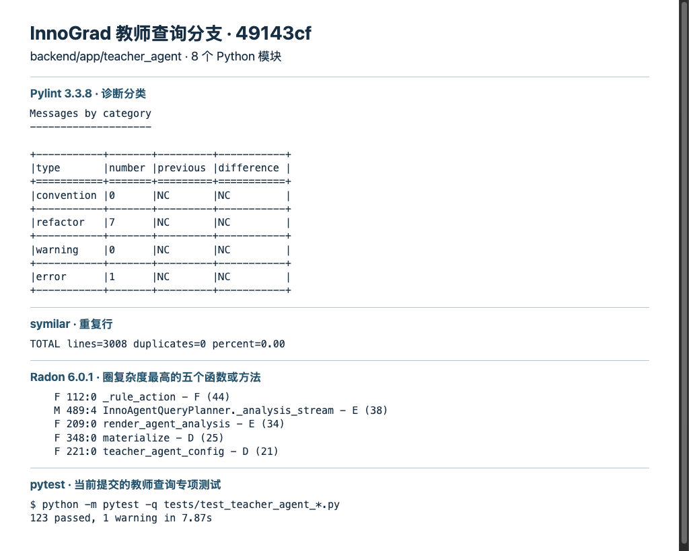
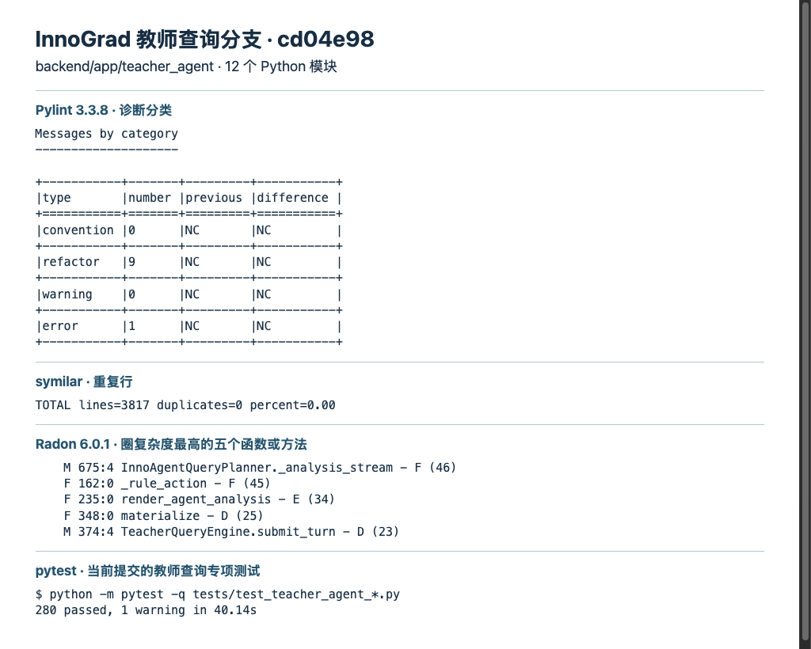

# 教师工作台分支代码质量报告

截至 2026 年 11 月 24 日，教师查询分支 `integration/xyt-teacher-agent` 的专项测试在已提交版本 `cd04e98` 上通过 280 项。当前最集中的维护问题在查询规划器：`_analysis_stream` 的圈复杂度为 46，`_rule_action` 为 45。

## 检查范围

本报告的静态扫描取样止于 `cd04e98`。后续可视化数据隔离修复的重构对比、实际操作截图及测试结果见[教师论文问答验收](teacher_visual_acceptance.md)。

[PR #44](https://github.com/NamingIsVeryVeryHard/InnoGrad/pull/44) 的目标分支是 `main`（`00d6ea3`）。`backend/app/teacher_agent` 和 `frontend/teacher-chat` 均是本分支新增的模块。后端质量指标统计教师查询包；前端检查覆盖教师聊天组件，发现见[代码评审报告](code_review.md)。两个取样版本均从 Git 提交直接导出。

## 扫描前后对比

`main` 中尚无教师查询包，因此选用分支上已有可运行查询、且位于 MCP 工具重构前的 `49143cf` 作基线，与当前提交 `cd04e98` 对比。两次使用同一目录和规则。期间新增了回合预算、授权、MCP 服务和可视化四个模块。

| 教师查询后端 | 重构前 `49143cf` | 当前 `cd04e98` |
| --- | ---: | ---: |
| 扫描的 Python 模块 | 8 | 12 |
| Bug 类告警（Pylint E） | 1 | 1 |
| Code Smell（Pylint R） | 7 | 9 |
| 单个函数或方法的最高圈复杂度（Radon） | 44 | 46 |
| 重复率（`symilar` 重复行 / 扫描行数） | 0 / 3,008（0.00%） | 0 / 3,817（0.00%） |
| 该提交自带的教师查询 pytest 用例 | 123 项通过 | 280 项通过 |

两版的 E 类告警均为 `papers.py` 的 `E1133`：Pylint 对遍历 Pydantic `model_fields` 构造学生候选项报错。学生消歧测试通过，现有证据未确认此处有运行故障。当前 9 条 R 类提示包括 7 条分支过多、2 条语句过多。功能增加后，专项测试覆盖扩大，最高圈复杂度也从 44 升至 46。

**重构前扫描**



**当前分支扫描**



## 分支已提交的五项改进

| 改动 | 改动前 | 改动后 |
| --- | --- | --- |
| 工具调用与重试 `63e2d16` | 查询执行、工具回调和重试规则集中在会话处理流程中 | 引入回合授权和 `TurnBudget`，分别限制成功查询、工具纠错和整轮重试；同轮的参数纠错共用预算。 |
| 分组分析 `581d5d0` | 汇总数字恰好等于某组数字时，生成的说明可能把总数写成分组结论 | 分组说明引用对应的结果卡；同轮的未分组查询仍保留自己的总数。 |
| 奖学金请求分流 `694b0dd` | 在论文会话中询问奖学金，可能沿用论文查询上下文 | 规划前先判断查询对象，对未开放的奖学金请求返回明确提示。 |
| 论文发表状态 `5d49c3b` | “按发表状态分组”与“只看已发表”可能触发同一过滤条件 | 分开解析分组和筛选意图，保留明确指定的单个或组合状态。 |
| 查询执行记录 `a8bfd20` | 未开放领域的请求可能生成执行记录，回看历史时出现多余结果卡 | 仅成功执行的查询写入记录；读取旧会话时仍展示提示，并移除该提示关联的无效结果卡。 |

## 复查

分别检出上述两个提交，在各自的 `backend` 目录、已安装项目依赖的 Python 3.11 环境中运行。扫描工具版本为 Pylint 3.3.8 和 Radon 6.0.1。

```sh
python -m pylint --disable=all --enable=F,E,too-many-branches,too-many-statements,duplicate-code \
  --persistent=no --reports=yes --score=no app/teacher_agent
symilar --ignore-comments --ignore-docstrings --ignore-imports --ignore-signatures app/teacher_agent/*.py
python -m radon cc -s app/teacher_agent
python -m pytest -q tests/test_teacher_agent_*.py
```

当前提交还通过了教师规划器扩展的 2 项 Node 测试，`frontend/teacher-chat` 的 6 个 JS/JSX 文件均通过项目 Prettier 格式检查。

[材料审核模块：本次专项报告](../../InnoGrad-portable-20261104/docs/software/code_quality.md)
