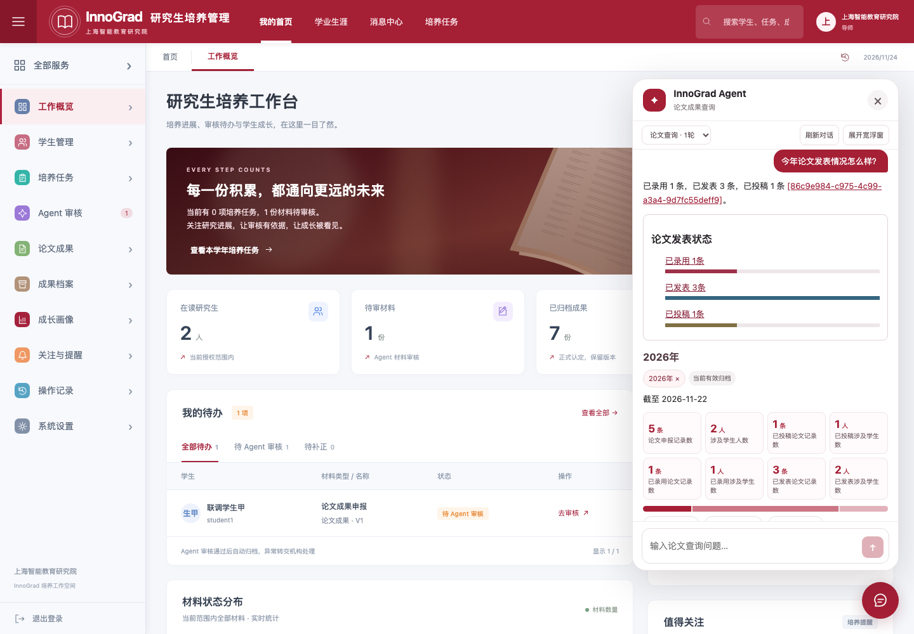
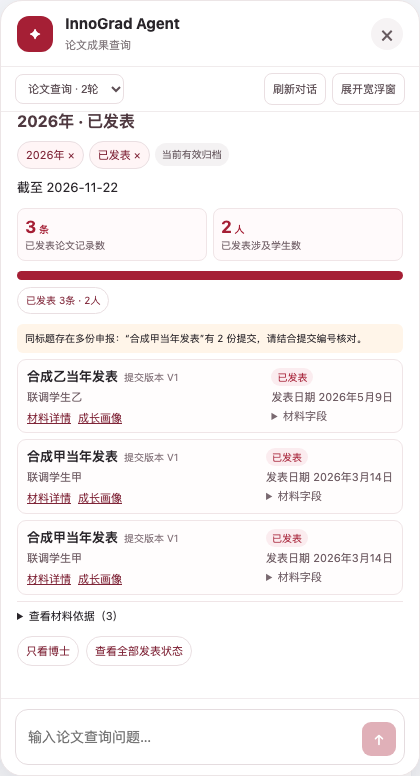
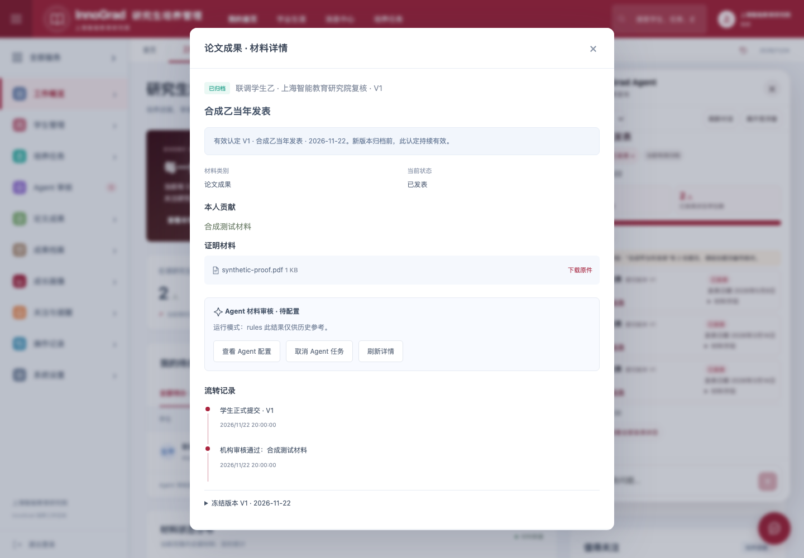
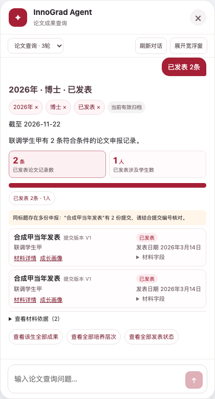

# 教师论文问答的浏览器验收

2026 年 11 月 24 日，使用 Chromium 从工作台登录教师账号，打开右下角的助手。验收使用隔离数据库里的合成学生和论文，连接实际模型服务与论文查询工具。测试时钟固定在 2026 年 11 月 22 日。论文状态、标题及归属的预期值取自有效指导关系内已批准的归档记录。

| 教师操作 | 页面表现 |
| --- | --- |
| 问“今年论文发表情况怎么样？” | 正文给出已录用 1 条、已发表 3 条、已投稿 1 条，并显示可点击的分组图。教师无需指定图表类型。 |
| 在概况后直接问“已发表的是哪几篇？” | 同一对话列出今年已发表的三条记录，覆盖两名学生。点击第一条的“材料详情”后，工作台打开对应材料。 |
| 追问“只看博士生呢？”，点图里的“已发表” | 打开博士生当年的两条已发表记录。两条记录标题相同，材料编号不同。刷新页面、刷新对话后仍能分别查看。 |
| 在指导权限撤销后重新打开历史对话 | 点名查询显示“查询范围已变更，本轮内容不可查看”。汇总查询按当前权限重算。 |

**复查记录。** 第一次用自然问法替代“请画条形图”时，`c6368f4` 查到了正确数据，但页面没有动态图。`09df4c8` 增加了按授权分组绘图的默认行为。模型提供有效布局时使用该布局，发表状态比较缺少可用布局时由工作台绘制。该版真实浏览器验收通过 137 项检查，实际调用论文工具 5 次。后端全量测试通过 341 项，有一条测试客户端依赖弃用提示。

**功能边界。** 布局支持条形图、环形图、指标、清单和时间线，交互可使用查询返回的分组条件或材料、学生编号。模型不能向页面注入可执行脚本。初次回答展示动态布局，历史重载展示重新校验权限的结果卡。

**最终验收。** `f3e83de` 增加了从概况追问论文清单、再点开材料的完整对话。145 项浏览器检查全部通过，6 次真实论文工具调用均匹配到查询回执。上面的五张截图来自本次运行。

**复现。** 在仓库根目录运行 `backend/.venv/bin/python fixtures/teacher-agent/acceptance/run_acceptance.py --commit f3e83de`。运行器输出本次截图、逐项检查结果和查询回执所在的目录。[环境与运行说明](../../fixtures/teacher-agent/acceptance/README.md)
