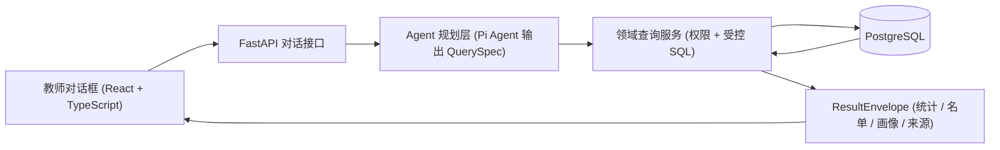

# 教师端 Agent 对话设计与分工方案

> [!NOTE]
> 本文档基于 2026 年 11 月 19 日同步的语雀文档 [整理-1118](https://www.yuque.com/lanjm/ygdlgt/utqa8odrvx21mv6g) 与 `main`（`00d6ea3`）代码状态整理，对应 GitHub 父任务 [#22](https://github.com/NamingIsVeryVeryHard/InnoGrad/issues/22) 及子任务 [#32](https://github.com/NamingIsVeryVeryHard/InnoGrad/issues/32)（后端 / zzb / `ivansnow02`）、[#33](https://github.com/NamingIsVeryVeryHard/InnoGrad/issues/33)（前端 / xyt / `AbracaSora`）。

## 1. 目标与边界

教师端 Agent 对话解决一个具体问题：教师在对话框用自然语言提问，系统直接返回可核验的统计数字、对应名单和学生画像，并支持继续筛选与原始材料追溯。

技术栈沿用团队已确定的方向：数据库采用 **PostgreSQL**，后端沿用 **FastAPI**，教师端新功能采用 **React + TypeScript**。

系统将“语言理解”和“数据计算”彻底拆开：

- **Agent** 负责理解自然语言、提取筛选条件、合并追问意图，并输出结构化查询指令。
- **后端领域查询服务** 负责权限校验、口径计算、执行受控 SQL，并组装结果和追溯链接。
- **前端** 负责渲染统计卡片、名单列表、筛选状态、学生画像面板和原始材料预览。

模型不直接生成或执行任意 SQL，也不自行汇总人数、份数和状态统计。

## 2. 架构与技术组件定位

### 2.1 主运行链路



每轮对话先由 Agent 将问题转为固定的 `QuerySpec`，再由后端查询服务在当前教师的授权范围内执行受控查询，最后返回统一的 `ResultEnvelope`。

### 2.2 各组件定位

| 技术或组件 | 建议定位 | 适用判断 |
| --- | --- | --- |
| FastAPI 领域查询服务 | 主运行路径，统一承担权限校验、受控查询、审计与结果封装 | 核心必建 |
| PostgreSQL 语义层 | 固化人数、份数、状态和时间范围的统计口径 | 优先建设 |
| MCP | 协议适配层，将后端领域查询工具暴露给 InnoAgent 或其他运行时 | 按需接入 |
| RAG | 检索指标定义、奖学金规则、学校制度和字段说明 | 适合规则问答，不负责数字统计 |
| CLI | 构造测试数据、跑回归查询、导出评测结果 | 适合开发与验收 |
| 数据库 MCP | 仅用于开发环境只读排查或内部分析 | 不作为教师端生产入口 |

关于语雀笔记中提到的 `dsh`：语雀与当前仓库均无项目内定义，公开资料主要指向 DeepSeek Harness 及其 RAG 插件。当前阶段不将 `dsh` 列为项目依赖。

### 2.3 权限与安全边界

应用层保留现有的教师指导关系校验，因为指导关系的有效期和角色语义由业务层维护。待全项目完成 PostgreSQL 底座切换后，再在数据库层叠加行级安全策略（RLS）作为纵深防护：启用 RLS 后，未匹配策略的行默认拒绝访问，防止查询实现漏加过滤条件。RLS 属于底座就绪后的加固项，不阻塞首期论文切片开发。

## 3. 现有代码复用与缺口

| 模块 | 现有能力（可直接复用） | 当前缺口（需要补齐） |
| --- | --- | --- |
| 权限范围 | 账号分 `student`、`teacher`、`manager`、`operator` 四类（见 [seed.py](../backend/app/seed.py#L12-L15)）。[policy.py](../backend/app/policy.py#L1-L19) 的 `relation` 与 `can_read`，以及 [workspace.py](../backend/app/workspace.py#L18-L24) 的 `scope_ids` 已统一按 `Supervision` 有效期控制范围：`teacher` 仅看本人指导学生，`manager` 新建学生时自动绑定管理范围（见 [workspace.py](../backend/app/workspace.py#L89-L90)），`operator` 默认空集 | 无需自建权限表，直接复用 `scope_ids`；若后续按学院筛选，待其他组在 `StudentProfile` 增加学院字段后接入白名单即可 |
| 状态字典 | 提交审核状态（`Submission.status`）已有 `draft`、`pending_review`、`returned`、`approved`、`archived` 5 个状态（见 [main.py](../backend/app/main.py#L63) 与 [worker.py](../backend/app/worker.py#L30)）；论文发表状态（`publication_status`）已有 `submitted`、`accepted`、`published`（见 [main.py](../backend/app/main.py#L411-L414)） | 现有代码无独立“彻底驳回（`rejected`）”状态，退回统一走 `returned`；二期奖学金需确认沿用现有状态还是补充“未获评”终态 |
| 画像与溯源 | [portraits.py](../backend/app/portraits.py#L43-L99) 的 `ensure_snapshot` 和 `GET /api/v1/students/{student_id}/portrait` 已提供归档来源、版本、文件与事实字段 | 论文只按当前有效申报记录计数，尚未完成成果主档去重（见 [portraits.py](../backend/app/portraits.py#L98) 说明） |
| Agent 契约 | InnoAgent 底层为 **Pi Agent**，支持对话内工具调用；共享契约参考 [agent_contracts.py](../InnoGrad-portable-20261104/backend/app/agent_contracts.py) 与 [InnoAgent统一接入接口.md](../InnoGrad-portable-20261104/docs/InnoAgent统一接入接口.md) | 当前 `main` 根目录 `backend/app/` 尚未合入共享 `agent_client.py` / `agent_contracts.py`；需基于 Pi Agent 工具调用能力注册受控查询工具，将自然语言转为 `QuerySpec` |
| 数据存储 | [pyproject.toml](../backend/pyproject.toml#L5) 已锁定 `psycopg[binary]`，[db.py](../backend/app/db.py#L157-L164) 已支持通过 `DATABASE_URL` 切换连接，部分迁移已做方言兼容 | 当前开发库仍是 SQLite，[backup.py](../backend/app/backup.py#L1-L34) 仍绑定 `sqlite3`；数据模型只有 `paper` 和 `annual` 两类提交，`StudentProfile` 目前含 `number`、`year`、`degree`、`major`、`direction`、`stage`，尚无学院字段（见 [db.py](../backend/app/db.py#L232-L241)） |
| 前端工程 | 已有原生 JavaScript 页面和后端鉴权会话 | 教师端新对话模块需要搭建 React + TypeScript 前端工程并打通鉴权与接口调用 |

## 4. 前后端接口契约

前后端开工前先冻结两个核心 JSON Schema：`QuerySpec` 和 `ResultEnvelope`。契约冻结后，后端按 Schema 实现执行引擎，前端即可基于 Mock 数据并行开发。

### 4.1 `QuerySpec`（结构化查询状态）

每一轮对话都必须规约成一份结构化的 `QuerySpec`。当教师追问“只看待补正的学生”时，后端读取上一轮持久化的 `QuerySpec` 并合并新增筛选条件，再重新执行查询。对话历史只用于界面展示，不作为 SQL 拼接依据。

```json
{
	"domain": "paper",
	"operation": "aggregate",
	"time_range": {
		"field": "publication_date",
		"from": "2026-01-01",
		"to": "2026-12-31"
	},
	"filters": [
		{
			"field": "publication_status",
			"operator": "eq",
			"value": "published"
		}
	],
	"group_by": [
		"publication_status"
	],
	"distinct_subject": "paper_record",
	"include": [
		"students",
		"sources"
	],
	"page": 1,
	"page_size": 50
}
```

### 4.2 `ResultEnvelope`（统一返回结构）

后端向前端返回固定信封，前端不自行二次聚合统计值。建议包含以下字段（细节由两人联调前拍板）：

```json
{
	"turn_id": "turn_01",
	"query_run_id": "run_01",
	"applied_query": {},
	"summary": {
		"metrics": [
			{
				"key": "paper_record_count",
				"label": "论文申报记录数",
				"value": 3,
				"drilldown_filter": {
					"field": "publication_status",
					"operator": "eq",
					"value": "published"
				}
			}
		],
		"data_as_of": "2026-11-19T09:00:00+08:00",
		"basis": "current_effective_archives",
		"notice": "统计基于当前有效申报记录，尚未完成成果主档去重。"
	},
	"items": [],
	"pagination": {
		"page": 1,
		"page_size": 50,
		"total": 3
	},
	"sources": []
}
```

### 4.3 奖学金核心指标字典

奖学金场景允许一人申报多个奖项，统计口径必须分开定义，避免把“人数”和“份数”混算：

| 指标名 | 唯一含义 |
| --- | --- |
| `applicant_count` | 去重后的申请学生人数 |
| `application_count` | 申请记录总份数 |
| `award_application_count` | 学生与奖项的申报关系总数（多对多展开计数） |
| `pending_review_count` | 当前状态为待审的申请记录数 |
| `correction_required_count` | 当前状态为待补正的申请记录数 |

## 5. 数据模型规划

### 5.1 对话与查询审计表（首期建设）

| 表名 | 职责 |
| --- | --- |
| `query_conversation` | 保存教师 ID、当前对话状态与授权范围快照 |
| `query_turn` | 保存教师原始问题、生成的 `QuerySpec`、工具调用记录、执行状态与结果摘要 |
| `query_run` | 保存实际执行口径、数据时间、结果版本、来源引用与下钻关联 |

### 5.2 奖学金业务表（二期建设）

| 表名 | 职责 |
| --- | --- |
| `scholarship_campaign` | 保存评审批次、年度、时间范围、规则版本与批次状态 |
| `scholarship_award` | 保存奖项名称、级别及所属评审批次 |
| `scholarship_application` | 保存学生、批次、申请状态、提交时间与当前版本指针 |
| `scholarship_application_award` | 保存申请记录与奖项的多对多关联 |
| `scholarship_application_version` | 保存申请表单快照、证明材料与审核依据 |

### 5.3 论文成果主档演进

当前论文字段存放在 `Submission.snapshot.form` 中，适合首期快速跑通链路，但无法稳定区分“独立论文成果数”和“论文申报记录数”。后续需要抽出独立的论文成果主档表，并在 `ResultEnvelope.summary.notice` 中明确标注当前统计口径。

## 6. 分阶段交付：先做论文，再做奖学金

### 6.1 首个纵向切片：今年论文发表情况

优先打通“今年论文发表情况”，原因很直接：

1. 仓库已有论文状态、投稿日期、录用日期、发表日期、学生和归档数据。
2. 仓库已有教师授权关系（`Supervision`）和学生画像接口（`portraits.py`）。
3. 仓库已有原始提交版本、归档记录和文件引用，能够直接验证“统计 → 名单 → 学生画像 → 原始材料”的完整下钻。
4. 奖学金目前没有业务表、奖项关系、正式状态定义和脱敏数据源。

本地开发库的模拟数据基线如下（仅用于构造回归评测，不代表真实业务数据）：

| 2026 年论文状态 | 论文记录数 | 涉及学生人数 |
| --- | --- | --- |
| 已发表（`published`） | 3 | 3 |
| 已录用（`accepted`） | 12 | 9 |
| 已投稿（`submitted`） | 3 | 3 |

### 6.2 第二个纵向切片：今年奖学金申请情况

拿到业务方确认的正式状态、奖项关系和脱敏样例后，接入奖学金表与语义层，重点验证多奖项申报下 `applicant_count`、`application_count` 与 `award_application_count` 的分项展示和点击下钻。

## 7. zzb 与 xyt 分工方案

### 7.1 职责划分

| 负责人 | 对应 Issue / 模块 | 具体交付物 |
| --- | --- | --- |
| **zzb**（`ivansnow02`） | [#32](https://github.com/NamingIsVeryVeryHard/InnoGrad/issues/32) 后端、查询引擎、Agent 与评测 | 1. 对话与查询审计表模型（`query_conversation`、`query_turn`、`query_run`）及遵循 SQLAlchemy 2.0 通用方言的 Alembic 迁移脚本（兼容 PG，不写 SQLite 专属 SQL）<br>2. `QuerySpec` 与 `ResultEnvelope` 校验 Schema 及 3 份标准 Mock 响应<br>3. FastAPI 对话接口与领域查询服务（含多轮 `QuerySpec` 合并、受控 SQL、分页与下钻过滤）<br>4. 接入现有 `scope_ids` / `relation` / `can_read` 权限校验；待公共 PG 底座合入后再落地 PG 语义视图与 RLS 加固<br>5. 基于 Pi Agent 注册受控查询工具，实现自然语言到 `QuerySpec` 的转换与校验修复<br>6. 论文查询固定评测集与回归校验脚本 |
| **xyt**（`AbracaSora`） | [#33](https://github.com/NamingIsVeryVeryHard/InnoGrad/issues/33) 前端（React + TypeScript）与交互 | 1. 教师端 React + TypeScript 工程搭建与会话鉴权接入<br>2. 对话界面框架（输入、多轮消息流、加载与错误态）<br>3. 统计卡片组件（展示指标口径、数据时间与免责提示，支持点击触发下钻）<br>4. 可下钻名单表格与动态筛选标签（支持回显当前 `QuerySpec` 条件并继续追问或手动清除筛选）<br>5. 学生画像侧边面板与原始材料来源追溯抽屉（对接 `GET /api/v1/students/{student_id}/portrait` 及文件引用） |
| **两人共同** | [#22](https://github.com/NamingIsVeryVeryHard/InnoGrad/issues/22) 契约、口径与验收 | 1. 冻结指标字典（论文记录数与奖学金 5 项指标）<br>2. 冻结 `QuerySpec` 与 `ResultEnvelope` 的 JSON Schema 及 Mock 样例<br>3. 对齐权限矩阵（导师、管理教师、无权限与撤销指导关系场景）<br>4. 编写首期端到端验收问题清单 |

### 7.2 与团队其他模块的职责边界

结合语雀 [整理-1118](https://www.yuque.com/lanjm/ygdlgt/utqa8odrvx21mv6g)、前期分工 [1102](https://www.yuque.com/lanjm/ygdlgt/gc52v0wrfudpgr0y) 与 GitHub Issues（`#22`–`#31`），以下边界须在团队内明确，避免重复改库或越界兜底：

- **全库 PostgreSQL 底座迁移（非本组负责）**：该任务属于全队公共基建（涵盖统一 PG 容器配置、在真实 PG 上验证既有 11 个 Alembic 迁移与后端测试、改造 [backup.py](../backend/app/backup.py#L1-L34) 的 `sqlite3` 依赖及决定历史测试数据迁移策略）。建议由主干或系统集成负责人（LANJM 或 jjy）单独建 Issue 牵头，ght 配合核对数据模型。本组开发期通过 `DATABASE_URL` 兼容运行，不等待也不包揽全库底座迁移。
- **6 类材料提交表单（jjy、ght、jkt 负责，`#23`–`#28`）**：论文、专利、软著、科研项目、竞赛与获奖、学术交流的表单字段与提交模型由该组设计。本组首期复用现有论文提交与归档表，后续按该组冻结的新模型接入查询。
- **成果申报表单（非本组负责，`#29`–`#31`）**：奖学金评审、年度报告评审与推免申报由其他成员认领推进。奖学金查询切片（二期）依赖 `#29` 确定的表单与关系模型。

### 7.3 协作与分支节奏

1. **先定契约再开工**：第一天先由两人评审并冻结 `QuerySpec` 与 `ResultEnvelope` 的 JSON Schema。zzb 提供 3 份标准 Mock 响应（统计汇总、继续筛选、单学生画像），xyt 据此独立开发前端组件。
2. **后端双轨验证**：zzb 先实现“直接传 `QuerySpec` 调查询服务”的接口并跑通数字核对，再接入 Pi Agent 做自然语言解析，避免把 LLM 解析问题和 SQL 逻辑问题混在一起排查。
3. **Git 分支规范**：`LANJM1` 已合并至 `main`（`00d6ea3`），后端开发分支为 `feat/zzb-teacher-agent-query`，按功能粒度提交 commit，完成后通过 PR 合入 `main`。

## 8. 验收顺序

按以下 6 步依次验收，前一步通过后再进入下一步：

1. **建立基准评测集**：基于当前开发库的论文模拟数据，固定一组带标准答案的查询用例（含人数、记录数、状态与日期范围）。
2. **验收受控查询引擎**：绕过 Agent，直接向后端发送 `QuerySpec`，核对返回的统计值、名单、分页与口径说明完全一致。
3. **验收 Agent 规划层**：输入自然语言与多轮追问，验证 Pi Agent 输出的 `QuerySpec` 通过 Schema 校验且与第 2 步的预期条件一致。
4. **验收前端交互链路**：在 React 页面完成“提问 → 查看统计卡片 → 点击卡片下钻名单 → 查看学生画像 → 追溯原始提交与文件”的完整闭环。
5. **验收权限边界**：切换不同教师账号，验证仅返回有效 `Supervision` 范围内的学生；撤销指导关系后再次查询，确认立即不可见；越权查学生画像返回 404。
6. **验收奖学金二期切片**：导入脱敏奖学金样例，核对一人报多项时 `applicant_count`、`application_count` 和 `award_application_count` 数值准确且可分别下钻名单。

## 9. 已确认结论与剩余待确认项

### 9.1 已确认（可直接按此推进）

- **全库 PG 底座迁移与成果申报表单（`#29`–`#31`）**：均不属于 zzb、xyt 负责范围，由团队其他成员认领推进，不阻塞首期论文切片开工。
- **奖学金数据源**：由学生在 InnoGrad 系统内直接填表产生，不依赖外部教务导入。
- **状态字典**：首期论文切片直接沿用现有 `Submission.status`（`draft`、`pending_review`、`returned`、`approved`、`archived`）和 `publication_status`（`submitted`、`accepted`、`published`）。
- **教师可见范围**：直接复用现有 `scope_ids` 与 `relation`，已天然覆盖 `teacher`（所带学生）、`manager`（名下管辖学生）和拦截 `operator` / `student`。
- **学院字段**：本组不负责维护来源；待其他组在 `StudentProfile` 补齐该列后，查询服务再接入筛选白名单。
- **Agent 工具调用能力**：InnoAgent 底层为 Pi Agent，支持在对话中直接调用结构化查询工具。

### 9.2 仍待团队或业务确认（仅影响二期奖学金与全库集成）

- [ ] **奖项与申请的关系（二期关键）**：同一批次内，学生报多个奖是“提交一份总申请勾选多个奖项”，还是“按奖项分别提交多份申请”？建议由认领 `#29`（奖学金评审成果申报表单）的同学同步拍板。
- [ ] **奖学金终态是否补充“未获评”**：现有审核流没有独立 `rejected` 状态（退回统一走 `returned`），二期奖学金需确认是否新增最终不通过状态。
- [ ] **上游认领与时间点**：团队明确全库 PG 底座迁移与 `#29`–`#31` 成果申报表的负责人及合入 `main` 节奏。
